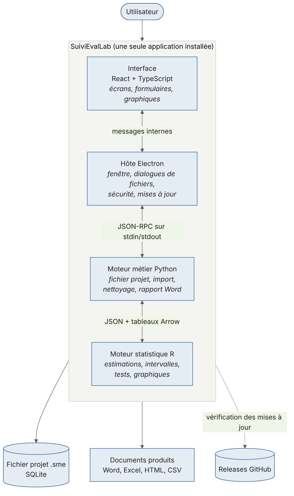

# Architecture et choix techniques

Ce chapitre explique de quoi l'application est faite et pourquoi. Il n'est pas nécessaire de le maîtriser pour utiliser SuiviEvalLab, mais il aide à comprendre son comportement (temps de démarrage, taille de l'installeur, fonctionnement hors ligne) et il est indispensable pour contribuer au code.

## Vue d'ensemble

SuiviEvalLab est une seule application pour l'utilisateur, mais elle réunit quatre composants qui travaillent ensemble sur son ordinateur :



*Figure 2. Architecture de SuiviEvalLab.*

| Composant | Technologie | Rôle |
|---|---|---|
| Interface | React 19, TypeScript, Vite | Tout ce que l'utilisateur voit : écrans, formulaires, tableaux, graphiques de l'analyse |
| Hôte | Electron 44 | La fenêtre Windows, les boîtes de dialogue de fichiers, le lancement des moteurs, la sécurité, les mises à jour |
| Moteur métier | Python 3.12 (polars, python-docx, pyreadstat, xlsxwriter) | Le fichier projet, l'import et le nettoyage des données, le diagnostic qualité, le rapport Word, le plan Excel, le tableau de bord |
| Moteur statistique | R 4.4 (survey, jsonlite, nanoarrow) | Tous les calculs statistiques : estimations, intervalles de confiance, comparaisons, tests, tailles d'échantillon, graphiques du rapport |
| Fichier projet | SQLite | Le stockage de tout le projet dans un fichier `.sme` |

Python et R sont **inclus dans l'installeur**. L'utilisateur n'a rien d'autre à installer, et les versions sont les mêmes sur tous les postes, ce qui garantit des résultats identiques d'un ordinateur à l'autre.

## Pourquoi trois langages

Le choix le plus visible est d'utiliser trois langages au lieu d'un. Chacun est le meilleur outil disponible pour sa partie, et les trois restent séparés par des contrats simples.

### R pour les statistiques

R est la référence internationale pour les statistiques d'enquête. Le package `survey` (Thomas Lumley) est l'implémentation la plus utilisée et la plus vérifiée des calculs avec pondération, strates et grappes : linéarisation de Taylor, intervalles logit pour les proportions, test de Rao-Scott, etc. Les mêmes calculs dans Python ou JavaScript seraient à réécrire et à valider, avec un risque d'erreur sur les chiffres que les projets présentent à leurs bailleurs.

Règle du projet : **tout résultat statistique est calculé par R**, jamais par Python ni par l'interface. Chaque fonction R renvoie aussi le script qui reproduit le résultat, ce qui permet à un statisticien de vérifier n'importe quel chiffre.

Alternatives écartées : coder les statistiques en Python (`statsmodels` ne couvre pas tous les plans de sondage aussi bien que `survey`) ; appeler R depuis Python par `rpy2` (un plantage de R ferait tomber Python).

### Python pour les données et les documents

Python est fort là où R est moins pratique : lire des fichiers Excel de forme irrégulière, gérer un fichier projet, remplir un modèle Word existant, produire un classeur Excel mis en forme. Le moteur Python utilise :

- **polars** pour les tableaux : rapide sur des fichiers de centaines de milliers de lignes ;
- **fastexcel** pour lire Excel ; **pyreadstat** pour SPSS et Stata ;
- **python-docx** pour le rapport Word, y compris sur le modèle de l'organisation ;
- **xlsxwriter** pour le plan de suivi Excel ;
- **sqlite3** (inclus dans Python) pour le fichier projet.

Le moteur Python est le **seul** à écrire dans le fichier projet et le **seul** à appeler R. L'interface ne parle qu'à lui.

### Electron, React et TypeScript pour l'interface

Une interface web offre ce qu'on attend aujourd'hui d'un logiciel : tableaux interactifs, graphiques, panneaux, thème clair et sombre, deux langues. Electron permet de livrer cette interface comme un vrai programme Windows, qui fonctionne sans navigateur ni serveur.

- **React** organise l'interface en composants réutilisables (panneaux, tableaux, champs).
- **TypeScript** vérifie les types à la compilation : une donnée mal formée entre l'interface et le moteur est détectée avant la livraison.
- **Vite** construit l'interface.

Alternatives écartées : une application web en ligne (les utilisateurs travaillent souvent sans connexion fiable, et les données ne doivent pas quitter le poste) ; une interface en Python (Qt ou Tkinter) ou en R (Shiny), moins riches et plus difficiles à installer proprement.

### SQLite pour le fichier projet

Un fichier SQLite est une petite base de données dans un seul fichier. C'est le format de stockage le plus répandu au monde : il est fiable en cas de coupure, il s'écrit à chaque modification sans tout réécrire, et il se copie comme n'importe quel fichier. Les données importées y sont rangées au format Parquet, compressé et typé.

## Comment les composants communiquent

| Liaison | Moyen | Pourquoi |
|---|---|---|
| Interface et hôte | Messages internes d'Electron, liste fermée de fonctions autorisées | L'interface ne peut appeler que les opérations prévues |
| Hôte et moteur Python | JSON-RPC 2.0 sur l'entrée et la sortie standard du processus | Aucun port réseau ouvert, donc rien n'est accessible de l'extérieur |
| Python et R | Messages JSON, et tableaux au format Arrow lus par `nanoarrow` | Les données passent vite et sans perte de type ; `nanoarrow` est léger à intégrer |

R tourne en **processus persistant** : il démarre une fois avec l'application, ce qui évite de payer son temps de démarrage à chaque calcul. Si R s'arrête, Python le relance ; si Python s'arrête, l'hôte le relance.

## Sécurité et confidentialité

- **Aucune donnée ne quitte l'ordinateur.** Pas de compte, pas de serveur, pas de statistiques d'usage envoyées.
- **L'interface ne manipule jamais un chemin de fichier.** Quand l'utilisateur choisit un fichier, l'hôte garde le chemin et donne à l'interface un jeton à usage interne. Une page piégée ne pourrait donc pas demander la lecture d'un fichier quelconque.
- **Aucune formule saisie par l'utilisateur n'est exécutée comme du code.** Les règles de calcul et de nettoyage sont des descriptions structurées, interprétées par les moteurs.
- **Les données importées ne sont jamais modifiées.** Le nettoyage s'applique à une copie, règle par règle.
- Le tableau de bord partageable ne contient que des résultats agrégés, et masque les groupes de moins de 5 observations.

## Installation et mises à jour

L'installeur Windows (environ 250 Mo) contient l'application, Python et R avec leurs packages. Il s'installe dans le compte de l'utilisateur, sans droits d'administrateur. Il n'est pas encore signé : Windows affiche donc un avertissement SmartScreen au premier lancement. La signature est prévue avant la bêta publique.

Depuis la version 0.3, l'application **se met à jour elle-même** à partir des publications du projet sur GitHub :

- au démarrage puis toutes les six heures, si internet est disponible, elle cherche une nouvelle version ;
- elle télécharge en arrière-plan **uniquement les parties qui ont changé** (environ 4 Mo pour une mise à jour courante, au lieu de 250 Mo) ;
- elle propose de redémarrer pour l'installer ; si l'utilisateur quitte simplement, la mise à jour s'installe à la fermeture ;
- les projets ne sont jamais touchés par une mise à jour.

Une organisation peut désactiver les mises à jour sur ses postes par stratégie de groupe : valeur `Updates` égale à `off` dans la clé de registre `HKLM\Software\Policies\SuiviEvalLab`. Le fichier `C:\ProgramData\SuiviEvalLab\update-policy.json` contenant `{"updates": "off"}` produit le même effet.

## Organisation du code

```
apps/desktop/          Interface et hôte (Electron, React, TypeScript)
  src/main/            Hôte : fenêtre, moteurs, sécurité, mises à jour
  src/renderer/        Interface : écrans (screens/), composants, traductions (i18n/)
engine/python/         Moteur métier
  sme_engine/          Fichier projet, import, nettoyage, qualité, fusion, rapport, plan, tableau de bord
  tests/               Tests automatiques du moteur
engine/r/              Moteur statistique
  R/                   Fonctions statistiques (préfixe sme_)
  tests/               Tests des fonctions R
tools/                 Scripts : préparation de Windows, tests de bout en bout, kit de test, documentation
docs/                  Documentation technique, décisions d'architecture (adr/), ce guide (guide/)
.github/workflows/     Intégration continue et publication
```

Les décisions techniques importantes sont consignées dans `docs/adr/` (une page par décision, avec le contexte, la décision et ses conséquences).
