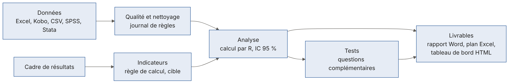

# Présentation de SuiviEvalLab

## À quoi sert l'application

SuiviEvalLab est un logiciel de bureau pour les équipes de suivi-évaluation. Il couvre le travail habituel d'un chargé de S&E, depuis le cadre de résultats jusqu'au rapport remis au bailleur, dans une seule application et sur l'ordinateur de l'utilisateur :

- construire le cadre de résultats du projet selon le modèle du bailleur (standard, Union européenne, USAID, Nations unies, Banque mondiale, ou niveaux propres) ;
- définir les indicateurs, leur règle de calcul, leur valeur de référence et leur cible, qu'ils viennent d'une enquête ou du suivi de routine (registres, rapports d'activité) ;
- importer les données d'enquête (Excel, export Kobo ou ODK, CSV, SPSS, Stata) ;
- diagnostiquer et nettoyer les données, créer des variables et contrôler leur cohérence, en gardant la trace de chaque correction ;
- calculer les indicateurs avec leur intervalle de confiance, en tenant compte du plan de sondage ;
- comparer la référence et la fin de projet, et tester d'autres questions avec un assistant ;
- produire le rapport Word, le plan de suivi Excel et un tableau de bord à partager.

Le parcours suit l'ordre dans lequel on travaille sur un projet réel :

*Figure 1. Le parcours de travail, du cadre de résultats aux livrables.*

## Pour qui

L'application vise d'abord les chargés et responsables de suivi-évaluation des ONG nationales et internationales, puis les consultants en évaluation et les services de S&E des administrations. Elle suppose une bonne connaissance du métier (cadre logique, indicateurs, enquêtes), mais aucune compétence en programmation ni en logiciel statistique.

## Ce qui la distingue des outils habituels

Un chargé de S&E travaille en général avec plusieurs outils : Kobo pour la collecte, Excel pour le nettoyage et les tableaux, SPSS, Stata ou R pour les statistiques quand l'équipe en a les compétences, puis Word pour le rapport. Chaque passage d'un outil à l'autre est une copie manuelle, donc une source d'erreur, et le lien entre un chiffre du rapport et les données d'origine se perd.

SuiviEvalLab garde ce lien de bout en bout :

| Besoin | Pratique courante | Dans SuiviEvalLab |
|---|---|---|
| Nettoyer les données | Modifications directes dans Excel, sans trace | Le fichier d'origine n'est jamais modifié ; chaque correction est une règle du journal, justifiée, réversible, citée dans le rapport et exportable en script R |
| Calculer un pourcentage pondéré | Formules Excel, souvent sans pondération ni intervalle | Calcul par R avec le package `survey`, pondération, strates et grappes, intervalle de confiance à 95 % |
| Comparer deux enquêtes | Différence de deux pourcentages, sans test | Différence, intervalle de la différence, valeur p et taille d'effet, avec la conclusion rédigée |
| Choisir un test statistique | Demander à un statisticien | L'assistant pose la question en termes de métier et choisit le test adapté |
| Rédiger le rapport | Copier-coller les chiffres et les graphiques | Rapport Word produit à partir du projet, sur le modèle de l'organisation |
| Vérifier un résultat | Difficile | Chaque résultat fournit le script R qui le reproduit |

L'application fonctionne **sans connexion internet**. Les données restent sur l'ordinateur : rien n'est envoyé vers un serveur. La seule connexion est la recherche de mises à jour, que l'utilisateur ou son organisation peut couper.

## Le fichier projet

Tout le travail d'un projet tient dans **un seul fichier** à l'extension `.sme` : le cadre de résultats, les indicateurs, une copie des données importées, le journal de nettoyage, les tests enregistrés et le modèle Word de l'organisation. Il n'y a pas de bouton « Enregistrer » : chaque modification est écrite immédiatement.

Ce fichier peut être copié, sauvegardé ou envoyé à un collègue qui a l'application : il retrouvera le projet dans l'état exact où il a été laissé. Une copie automatique est faite à chaque ouverture, ce qui permet de revenir en arrière après une erreur (voir [Outils](manuel/outils.md)).

## État du projet

| Version | Contenu | État |
|---|---|---|
| 0.1 | Fondations : application Windows, moteurs Python et R intégrés, calcul de démonstration | Publiée |
| 0.2 | Premier parcours complet : cadre, indicateurs, import, nettoyage, calcul par R, comparaison, rapport Word | Publiée |
| 0.3 | Libellés Kobo, nouveaux types d'indicateurs, assistant de tests, modèle Word de l'organisation, SPSS et Stata, fusion de fichiers, tableau de bord partageable, diagnostic qualité, vérifications avant le rapport, copies automatiques, taille d'échantillon, plan de suivi Excel, mises à jour automatiques | Publiée |
| 0.4 | Modèles de cadre par bailleur et hypothèses, indicateurs de suivi de routine, nettoyage avancé (variables calculées, classes, dates et durées, contrôles de cohérence, texte), empilement de fichiers, journal exporté en script R | En cours de publication |

Prochaines étapes envisagées : récupération directe des données depuis KoboToolbox, passage des données du format large au format long, autres questions statistiques (corrélation, variables ordinales), puis une phase bêta avec des utilisateurs de terrain. Le travail à plusieurs sur un même projet avec des droits par indicateur est prévu après la version 1.0.

## Organisation de ce document

1. **Présentation** (ce chapitre).
2. **Architecture et choix techniques** : les briques logicielles, leur rôle et les raisons de ces choix.
3. **Manuel de l'application** : chaque écran, chaque option.
4. **Contribuer au projet** : poste de développement, règles, cycle de travail, publication.
5. **Tester l'application** : tests automatiques et kit de test pour les testeurs.
6. **Annexes** : glossaire, méthodes statistiques, sources des données.

Les captures d'écran proviennent de la version 0.3 en français, ouverte sur le projet d'exemple fourni avec l'application (enquêtes REACH en Irak, 2019 et 2020) et sur une enquête REACH-UNICEF au Bangladesh (2018).
