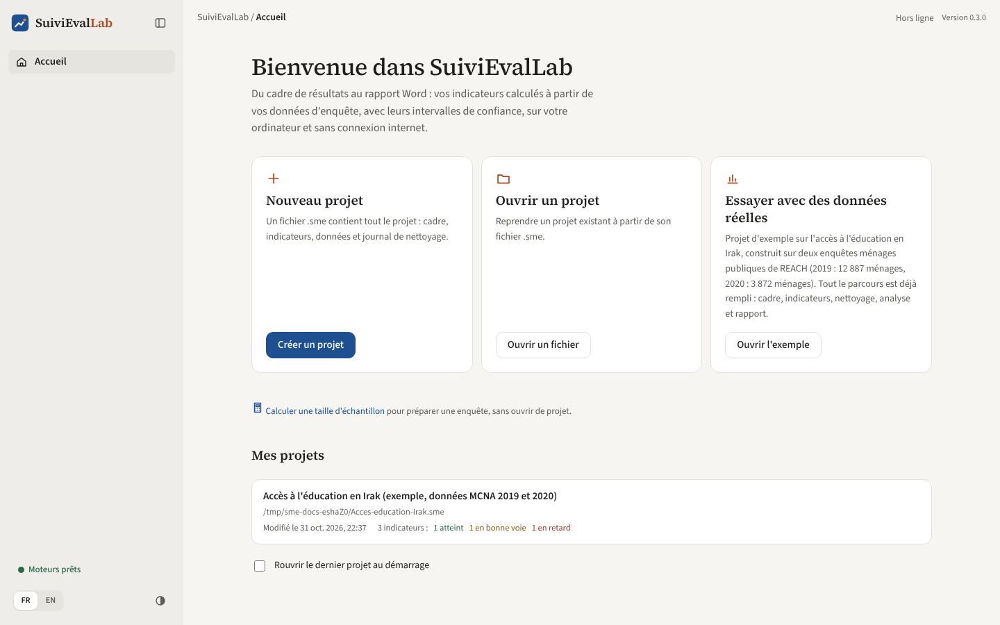
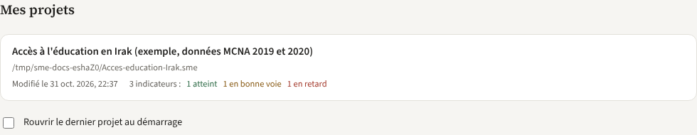

# Prise en main et accueil

## Installer l'application

1. Téléchargez `SuiviEvalLab-<version>-installation.exe` sur la page *Releases* du dépôt GitHub (Windows 10 ou 11, 64 bits, environ 250 Mo).
2. Lancez-le. L'installeur n'étant pas encore signé, Windows peut afficher « Windows a protégé votre ordinateur » : cliquez sur « Informations complémentaires », puis « Exécuter quand même ».
3. L'installation se fait dans le compte de l'utilisateur, sans droits d'administrateur. Un raccourci est créé sur le bureau.

Pour passer d'une version à la suivante, il n'est pas nécessaire de désinstaller : le nouvel installeur remplace l'ancienne version. Depuis la version 0.3, les mises à jour arrivent d'elles-mêmes (voir [Outils](outils.md)).

## L'écran d'accueil

*Figure 3. L'écran d'accueil, avec la liste « Mes projets ».*

L'accueil propose trois façons de commencer :

| Bloc | Action | Ce qui se passe |
|---|---|---|
| **Nouveau projet** | « Créer un projet », saisir un nom, puis « Choisir l'emplacement » | Un fichier `.sme` vide est créé à l'endroit choisi et le projet s'ouvre sur le cadre de résultats |
| **Ouvrir un projet** | « Ouvrir un fichier » | Ouvre un fichier `.sme` existant, par exemple reçu d'un collègue |
| **Essayer avec des données réelles** | « Ouvrir l'exemple » | Crée un projet complet à partir de deux enquêtes publiques (REACH, Irak, 2019 et 2020) : cadre, trois indicateurs, données, nettoyage. Idéal pour découvrir l'application |

Le lien **« Calculer une taille d'échantillon »** ouvre le calculateur sans ouvrir de projet (voir [Outils](outils.md)).

Les boutons qui ont besoin des moteurs de calcul restent grisés pendant leur démarrage, qui prend quelques secondes après l'ouverture de l'application. L'indicateur en bas à gauche passe alors à **« Moteurs prêts »**.

## Mes projets

La liste **Mes projets** rassemble les projets créés ou ouverts sur cet ordinateur, du plus récent au plus ancien.

*Figure 4. Un projet dans la liste, avec l'état de ses indicateurs.*

Pour chaque projet, la ligne indique :

- son nom et l'emplacement du fichier ;
- la date de dernière modification ;
- le nombre d'indicateurs et leur état (atteints, en bonne voie, en retard) au moment de la dernière ouverture ;
- « Fichier introuvable à cet emplacement » si le fichier a été déplacé ou supprimé.

Un clic sur la ligne ouvre le projet. Au survol, trois boutons apparaissent :

| Icône | Action |
|---|---|
| Horloge | **Copies automatiques** : liste des copies du projet et restauration (voir [Outils](outils.md)) |
| Dossier | **Afficher dans le dossier** : ouvre l'explorateur Windows sur le fichier |
| Croix | **Retirer de la liste** : le projet disparaît de la liste, le fichier n'est pas supprimé |

Au-delà de quatre projets, un champ **« Chercher un projet »** filtre la liste par nom ou par emplacement. La case **« Rouvrir le dernier projet au démarrage »** fait ouvrir directement le dernier projet utilisé au lancement de l'application.

## Les éléments communs à tous les écrans

**La barre latérale (à gauche)**

- Le nom du projet ouvert, puis les sept étapes : Vue d'ensemble, Cadre de résultats, Indicateurs, Données, Analyse, Tests, Rapport. Le chiffre à droite de certaines étapes indique le nombre d'éléments (indicateurs, jeux de données, etc.).
- **Fermer le projet** : revient à l'accueil. Rien n'est perdu, tout est déjà enregistré.
- **Moteurs prêts** : état des moteurs de calcul ; un clic ouvre l'écran Moteurs.
- **FR / EN** : langue de l'interface. Le choix est mémorisé.
- **Thème** (cercle à moitié plein) : bascule entre clair et sombre.
- Le bouton en haut de la barre la replie, pour gagner de la place sur un petit écran.

**La barre du haut**

- Le fil d'Ariane : application, projet, écran.
- **« Enregistré automatiquement »** : rappel qu'il n'y a pas de bouton Enregistrer. Pendant un calcul long, le message devient « Traitement en cours ».
- Le numéro de version installée.

**Les panneaux**

Les formulaires (nouvel indicateur, règle de nettoyage, import, fusion, etc.) s'ouvrent dans un panneau à droite. La touche Échap ou la croix le ferme sans rien enregistrer ; le bouton principal en bas du panneau valide.
