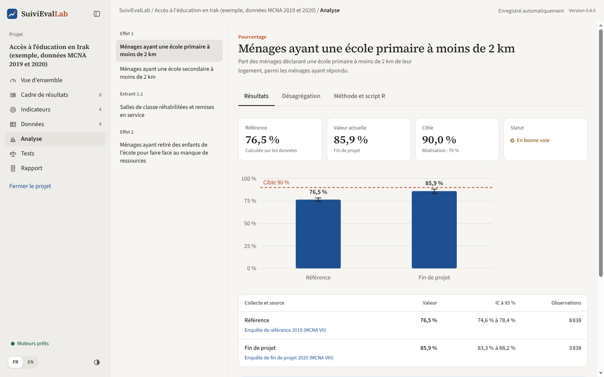
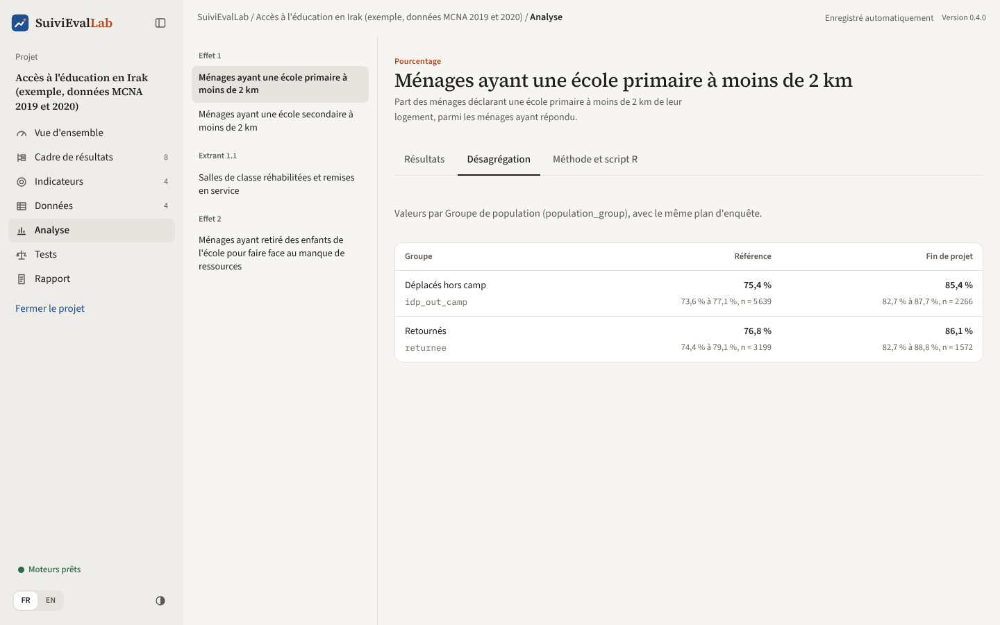
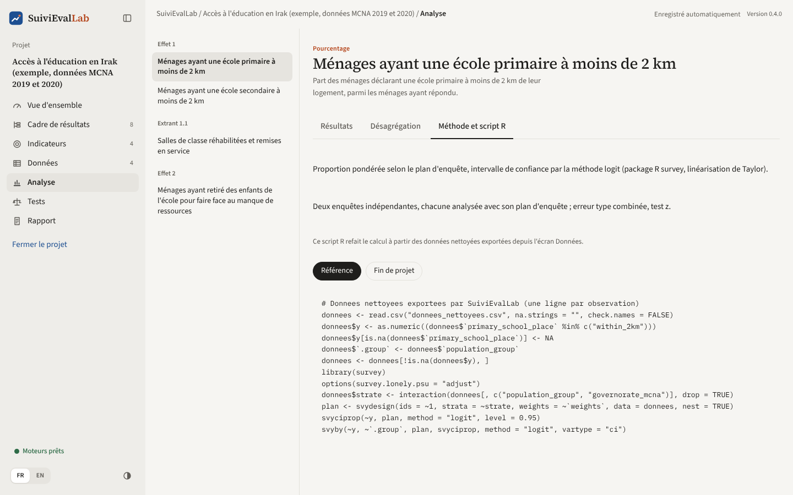
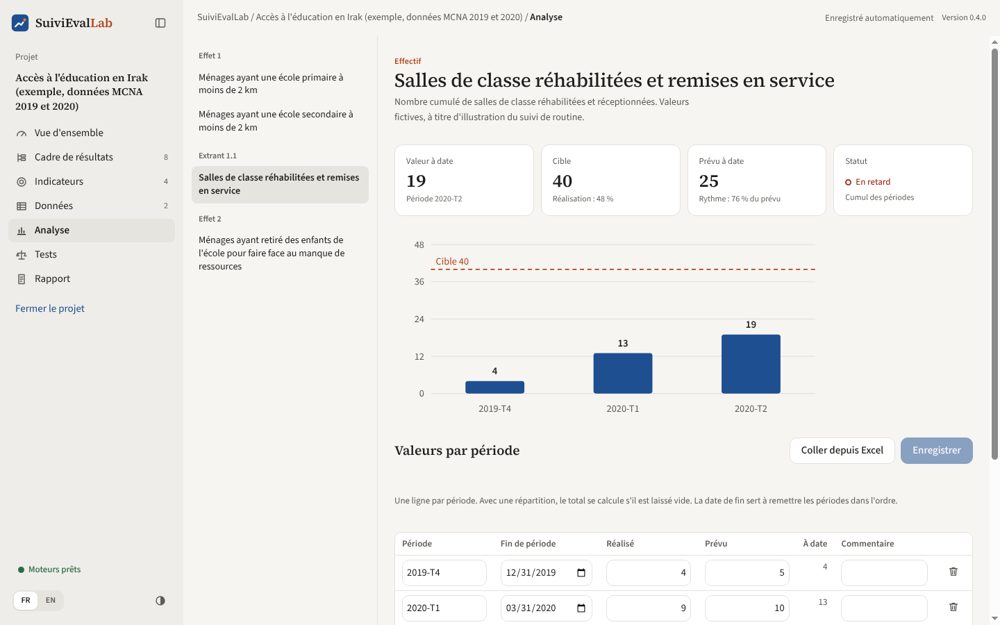
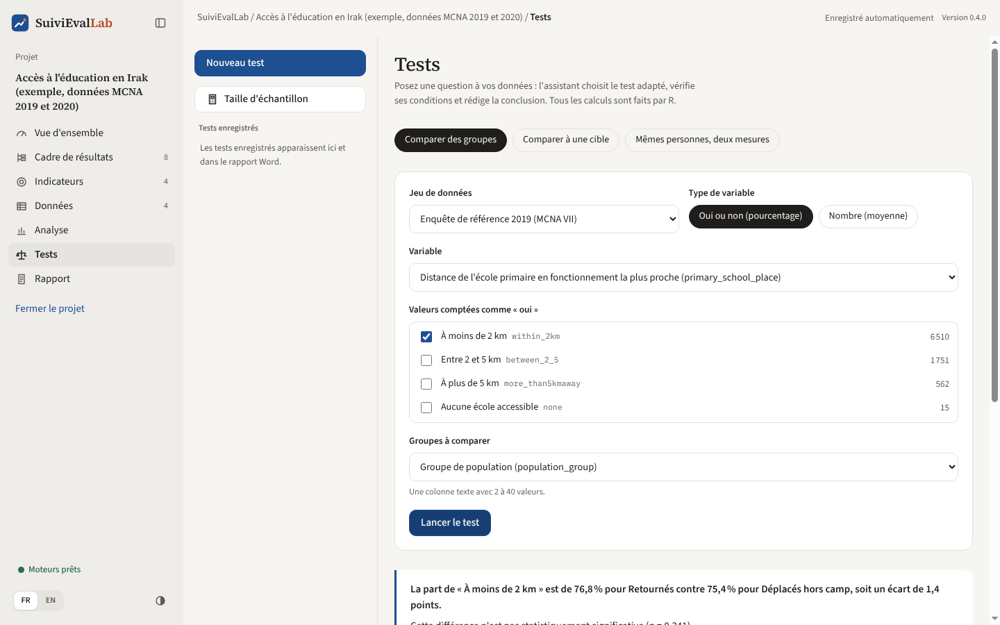

# Analyse et tests

## Analyse des indicateurs

L'écran Analyse présente, indicateur par indicateur, les valeurs calculées par R pour chaque collecte et la comparaison entre la référence et la fin de projet. La liste à gauche permet de passer d'un indicateur à l'autre ; elle est groupée par résultat.

*Figure 26. Analyse : valeurs par collecte, intervalles de confiance et cible.*

### Onglet Résultats

- **Quatre chiffres** : référence (avec son origine : calculée sur les données ou saisie à la main), valeur actuelle (avec la collecte), cible (avec le taux de réalisation) et statut.
- **Le graphique** : une barre par collecte, avec l'intervalle de confiance à 95 % (trait vertical) et la cible (ligne pointillée).
- **Le tableau** : pour chaque collecte, le jeu de données, la valeur, l'intervalle de confiance et le nombre d'observations utilisées.
- **La comparaison référence et fin de projet** : la différence, son intervalle de confiance, la valeur p et la conclusion en une phrase, par exemple :

> La valeur passe de 76,5 % à 85,9 %, soit une hausse de 9,4 points (IC à 95 % de la différence : 6,2 à 12,5). La différence est statistiquement significative (p < 0,001).

Sous la conclusion : le test utilisé et la **taille d'effet** (h de Cohen pour un pourcentage, d de Cohen pour une moyenne), qui dit si la différence est importante en pratique et pas seulement « significative ».

**Lire l'intervalle de confiance.** L'intervalle de 74,5 % à 78,5 % signifie qu'avec la taille et le plan de l'échantillon, la vraie valeur dans la population se trouve très probablement dans cette fourchette. Deux intervalles qui se chevauchent n'impliquent pas que la différence soit non significative : c'est la comparaison, et non le chevauchement, qui le dit.

**Messages possibles.**

| Message | Signification |
|---|---|
| « Une seule collecte disponible » | La comparaison apparaîtra quand une collecte de fin de projet (ou de suivi) sera importée |
| « La colonne X est absente de : ... » | Un jeu de données n'a pas la colonne de la règle ; il est ignoré pour cet indicateur |
| Avertissement rouge sur les poids | Effectifs comparés entre deux enquêtes dont les poids ne sont pas à la même échelle : la comparaison n'a pas de sens (voir [Données](donnees.md)) |
| Comparaison « sans test statistique » | Effectifs sans plan de sondage : la différence est décrite, mais aucun test n'est possible |

### Onglet Désagrégation

*Figure 27. Valeurs par groupe de population, référence et fin de projet.*

Les valeurs de chaque groupe, pour chaque collecte, avec leur intervalle de confiance et leur effectif. Les groupes affichent leur libellé et, en dessous, leur code.

### Onglet Méthode et script R

*Figure 28. La méthode en clair, et le script R qui reproduit le calcul.*

La méthode d'estimation et le test de comparaison, en une phrase chacun, puis le **script R** de chaque collecte. Ce script refait exactement le calcul à partir des données nettoyées exportées depuis l'écran Données : un statisticien, un auditeur ou un bailleur peut ainsi vérifier n'importe quel chiffre sans l'application.

### Méthodes utilisées

| Situation | Estimation | Comparaison de deux enquêtes |
|---|---|---|
| Pourcentage, avec plan d'enquête | `svyciprop`, méthode logit (package `survey`) | Différence, erreur type combinée, test z |
| Pourcentage, échantillon simple | Intervalle de Wilson | Test du khi-deux |
| Moyenne, avec plan | `svymean`, linéarisation de Taylor | Différence, erreur type combinée, test z |
| Moyenne, échantillon simple | Intervalle de Student | Test t de Welch |
| Effectif, avec plan | `svytotal` (nombre estimé dans la population) | Différence, erreur type combinée, test z |
| Effectif, échantillon simple | Comptage observé | Description, sans test |
| Ratio | `svyratio`, méthode delta | Différence, erreur type combinée, test z |

### Indicateurs de suivi de routine

Pour un indicateur de suivi de routine, l'écran Analyse sert aussi à **saisir les valeurs**. Il n'y a ni intervalle de confiance ni onglets : ce sont des comptages et des relevés, pas un échantillon.

*Figure 29. Le suivi de routine des salles de classe réhabilitées, trimestre par trimestre.*

- **Quatre chiffres** : la valeur à date (avec la dernière période renseignée), la cible et le taux de réalisation, le **prévu à date** et le rythme par rapport au prévu, et le statut.
- **Le graphique** : la valeur à date à la fin de chaque période, avec la cible.
- **Le tableau des valeurs** : une ligne par période, avec son nom (« 2026-T1 », « Janvier 2026 »), sa date de fin, le réalisé, le prévu, éventuellement une colonne par catégorie de la répartition, et un commentaire. La colonne « À date » affiche le cumul (ou la dernière valeur, ou la moyenne, selon l'indicateur) après enregistrement.

**« Ajouter une période »** ajoute une ligne ; la corbeille en retire une. Pour un indicateur en pourcentage, on saisit 45 ou 0,45 indifféremment. Les périodes sont remises dans l'ordre de leur date de fin. **« Enregistrer »** valide l'ensemble et met à jour les chiffres, la vue d'ensemble et le rapport.

**« Coller depuis Excel »** ouvre une zone où coller des lignes copiées dans un tableur, dans l'ordre : période, date de fin, réalisé, prévu, puis une colonne par catégorie. Une première ligne d'en-têtes est ignorée. Les lignes lues remplacent le tableau, qu'il reste à enregistrer.

Dans le projet d'exemple, l'indicateur « Salles de classe réhabilitées et remises en service » montre un cas typique : 19 salles réceptionnées pour 25 prévues à la fin du deuxième trimestre 2020, à cause de chantiers suspendus pendant le confinement. Le rythme est de 76 % du prévu : l'indicateur est en retard. Ses valeurs sont fictives.

Dans le rapport Word, chaque indicateur de suivi de routine a sa phrase de lecture, son graphique et le tableau des périodes ; la méthode est décrite en annexe.

## Assistant de tests

L'assistant répond aux questions que l'on se pose au-delà des indicateurs, **sans avoir à connaître le nom du test** : on décrit la question, l'application choisit la méthode adaptée aux données et au plan d'enquête, et rédige la conclusion.

*Figure 30. Comparer la part de ménages proches d'une école entre groupes de population.*

### Les trois questions

| Question | Exemple | Ce qu'il faut choisir |
|---|---|---|
| **Comparer des groupes** | La valeur diffère-t-elle entre hommes et femmes, entre régions, entre groupes de population ? | La variable, les valeurs comptées comme « oui » (pour un pourcentage), la colonne des groupes (2 à 40 groupes) |
| **Comparer à une cible** | La valeur observée atteint-elle, dépasse-t-elle ou reste-t-elle sous la cible ? | La variable et la cible |
| **Mêmes personnes, deux mesures** | Les mêmes ménages ont-ils changé entre avant et après ? | Deux colonnes du même fichier (score avant, score après), ou deux fichiers reliés par un identifiant |

Pour chaque question, on choisit aussi le **jeu de données** et le **type de variable** : « Oui ou non (pourcentage) » ou « Nombre (moyenne) ».

### Le résultat

**« Lancer le test »** affiche :

- la **conclusion rédigée** : d'abord l'ampleur (« 76,8 % pour Retournés contre 75,4 % pour Déplacés hors camp, soit un écart de 1,4 point »), puis la significativité (« pas statistiquement significative, p = 0,362 »), puis la taille d'effet et ses limites ;
- le tableau des groupes avec leurs intervalles de confiance ;
- le test utilisé, la statistique, les degrés de liberté, la valeur p, le nombre d'observations ;
- si le plan d'enquête a été pris en compte ;
- le script R.

### Les tests choisis par l'assistant

| Question | Sans plan d'enquête | Avec plan d'enquête |
|---|---|---|
| Groupes, pourcentage | Khi-deux, ou Fisher exact si un effectif attendu est inférieur à 5 | Khi-deux de Rao-Scott (`svychisq`) |
| Deux groupes, moyenne | Test t de Welch | `svyttest` |
| Trois groupes ou plus, moyenne | ANOVA de Welch | Régression `svyglm` avec test de Wald |
| Cible, pourcentage | Test binomial exact | Test z sur l'estimation pondérée |
| Cible, moyenne | Test t à un échantillon | Test z sur l'estimation pondérée |
| Avant et après, nombre | Test t apparié (Wilcoxon si la distribution l'impose) | Prévu |
| Avant et après, oui ou non | Test de McNemar (exact pour les petits effectifs) | Prévu |

Tailles d'effet : V de Cramér, g de Hedges, oméga carré, h et d de Cohen, dz pour les mesures appariées.

### Enregistrer un test

Donnez un **titre** au test puis **« Ajouter au rapport »**. Il apparaît dans la liste « Tests enregistrés » à gauche et dans la partie **Analyses complémentaires** du rapport Word. Il est recalculé à chaque génération du rapport : si les données ou le nettoyage changent, la conclusion suit.
