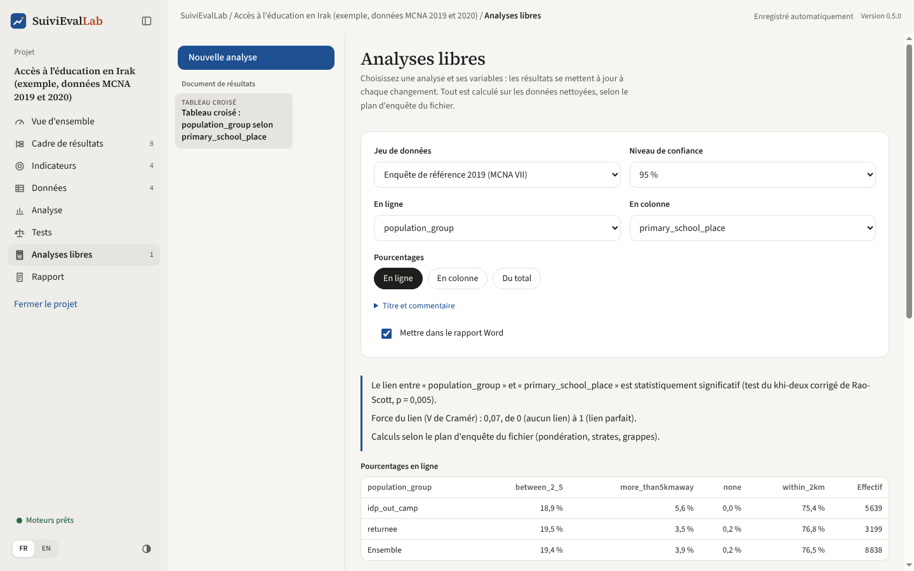
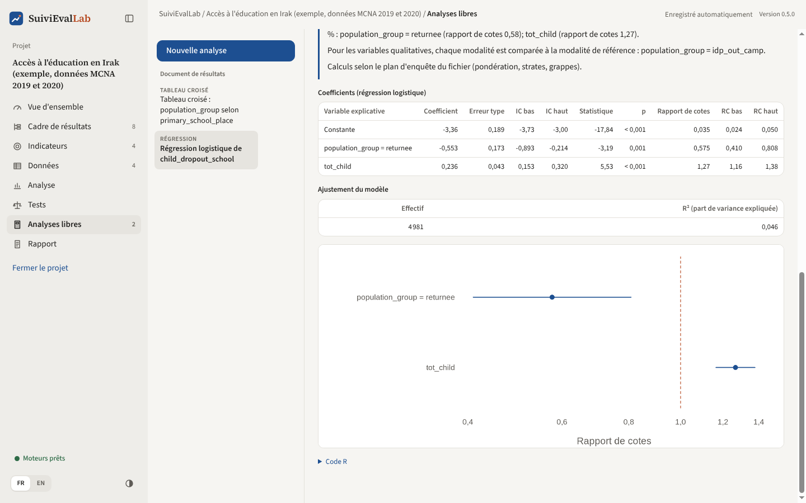
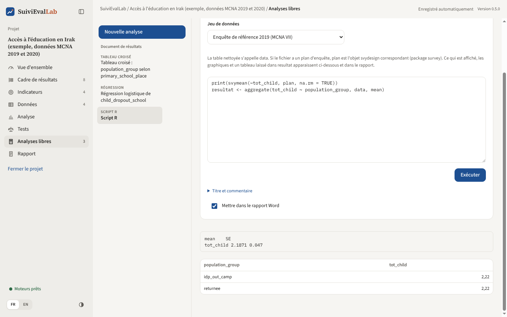

# Analyses libres

L'écran Analyse suit les indicateurs du cadre de résultats, et l'assistant de tests répond à une question précise. L'écran **Analyses libres** sert à tout le reste : explorer les données, croiser deux variables, comparer des groupes, expliquer un résultat par plusieurs facteurs, mesurer l'effet d'un projet. Il fonctionne comme JASP : on choisit une analyse, on désigne ses variables, et les résultats se mettent à jour à chaque changement.

Toutes les analyses portent sur les **données nettoyées** et suivent le **plan d'enquête** du fichier (pondération, strates, grappes), réglé dans l'écran Données. Les calculs sont faits par R, avec le package `survey` quand le fichier a un plan d'enquête.

*Figure 34. Un tableau croisé : la lecture en mots, les pourcentages pondérés, le test et le graphique.*

## Le document de résultats

La colonne de gauche est le **document de résultats** : la liste des analyses du projet, dans l'ordre où elles apparaîtront dans le rapport Word. Chaque analyse est enregistrée dans le fichier projet et recalculée quand les données ou leur nettoyage changent. Les flèches changent l'ordre, la corbeille supprime l'analyse.

**« Nouvelle analyse »** propose sept analyses. Pour chacune :

1. choisissez le **jeu de données** et, si besoin, le **niveau de confiance** (90, 95 ou 99 %) ;
2. désignez les **variables** : le calcul part dès que les options sont complètes ;
3. sous « Titre et commentaire », donnez un titre (sinon un titre est proposé) et votre interprétation, reprise dans le rapport sous le titre ;
4. la case **« Mettre dans le rapport Word »** est cochée par défaut.

Les résultats commencent par une **lecture en mots**, puis viennent les tableaux, le test, le graphique et le **code R** qui donne le même résultat à partir des données nettoyées exportées (Données, « Exporter les données nettoyées »). Le code se copie d'un clic, pour vérifier un calcul ou le poursuivre dans R.

## Les analyses

| Analyse | Variables | Ce qui est calculé | Avec plan d'enquête | Sans plan d'enquête |
|---|---|---|---|---|
| **Statistiques descriptives** | Une ou plusieurs variables, un groupe facultatif | Nombres : effectif, moyenne, erreur type, intervalle de confiance, écart type, médiane, quartiles, minimum, maximum. Variables qualitatives : part de chaque valeur avec son intervalle | `svymean`, `svyquantile`, `svyvar`, `svyciprop` (logit) | Moyenne et intervalle de Student, intervalle de Wilson |
| **Tableau croisé** | Deux variables qualitatives | Pourcentages en ligne, en colonne ou du total ; effectifs observés ; V de Cramér | Pourcentages pondérés, khi-deux corrigé de Rao-Scott (`svychisq`) | Khi-deux, ou test exact de Fisher si des effectifs attendus sont faibles |
| **Comparer des moyennes** | Une variable numérique, une variable de groupe | Moyenne de chaque groupe avec son intervalle, écart entre deux groupes | Test t pour plan d'enquête (`svyttest`) ; au-delà de deux groupes, test F global d'une régression (`svyglm`, `regTermTest`) | Test t de Welch ; ANOVA de Welch |
| **Corrélations** | Deux à douze variables numériques | Matrice des coefficients de Pearson et de leurs valeurs p | Variances et covariances pondérées (`svyvar`) | `cor`, `cor.test` |
| **Régression** | Une variable à expliquer, jusqu'à quinze variables explicatives | Coefficients, erreurs types, intervalles, valeurs p ; rapports de cotes en logistique ; R² | `svyglm` (gaussienne ou quasi-binomiale) | `lm`, `glm` binomiale |
| **Différence de différences** | Un résultat (moyenne ou part de « oui »), une colonne de groupe, une colonne de période | Les quatre moyennes (bénéficiaires et comparaison, avant et après) et l'effet estimé avec son intervalle | `svyglm` avec l'interaction groupe × période | `lm` avec la même interaction |
| **Script R** | Votre code | Ce que le code affiche, ses graphiques et un tableau | Le plan est fourni dans `plan` | |

Une variable est traitée comme un nombre quand toutes ses valeurs sont des nombres et qu'elle en a plus de dix différentes ; sinon comme une variable qualitative. Le choix « Traiter comme » de chaque variable change ce réglage, par exemple pour un score de 1 à 5.

### Régression

*Figure 35. Régression logistique : rapports de cotes et leur intervalle, à autres variables égales.*

- **Linéaire** pour expliquer une variable numérique (revenu, dépenses, score). **Logistique** pour une réponse oui ou non : cochez les valeurs qui comptent comme « oui ».
- Une variable explicative dont les valeurs sont du texte est traitée comme qualitative ; cochez « qualitative » pour un code numérique (région codée 1, 2, 3). Chaque valeur est alors comparée à la première, dite de référence, rappelée dans la lecture.
- La lecture cite les variables qui ont un effet statistiquement significatif au seuil de 5 %, avec leur coefficient ou leur rapport de cotes. Le graphique montre chaque effet avec son intervalle : un intervalle qui traverse la ligne pointillée (0, ou 1 pour un rapport de cotes) n'est pas significatif.

### Différence de différences

La différence de différences estime l'effet d'un projet en comparant l'**évolution** des bénéficiaires à celle d'un **groupe de comparaison**. Il faut un fichier qui contient les deux collectes : empilez les fichiers de référence et de fin de projet dans l'écran Données (la colonne `source_file` indique alors la période), ou utilisez une enquête qui a déjà une colonne de période.

1. Choisissez le résultat : une **moyenne**, ou une **part de réponses** (cochez alors les valeurs qui comptent).
2. Choisissez la **colonne du groupe** et cochez les valeurs des bénéficiaires ; les autres lignes forment le groupe de comparaison.
3. Choisissez la **colonne de la période** et cochez les valeurs de la période « après ».

Le résultat donne les quatre moyennes et la différence de différences avec son intervalle de confiance. La lecture rappelle l'hypothèse sur laquelle repose la méthode : sans le projet, les deux groupes auraient évolué de la même façon (tendances parallèles). Elle est plausible quand les deux groupes se ressemblent et évoluaient de la même façon avant le projet.

### Script R

*Figure 36. Un script R : la sortie de R et le tableau laissé dans resultat.*

Le script reçoit la table nettoyée dans `data` et, si le fichier a un plan d'enquête, l'objet `plan` créé par `svydesign` du package `survey`. Tout ce qu'il affiche, ses graphiques et un tableau laissé dans la variable `resultat` (ou `result`) apparaissent sous le code et dans le rapport. Le script s'exécute avec le bouton **« Exécuter »** et non à chaque frappe. Comme dans le nettoyage, il ne tourne que s'il a été écrit ou accepté sur cet ordinateur (voir [Données](donnees.md#code-r-recu-dune-autre-personne)).

## Dans le rapport

Les analyses cochées forment la section **« Analyses statistiques »** du rapport Word : pour chacune, son titre, le jeu de données, votre commentaire, la lecture, les tableaux, le test et les graphiques. L'écran Rapport permet de choisir, analyse par analyse, d'inclure ou non la lecture, les tableaux, les graphiques et le code R (voir [Rapport](rapport.md)).
