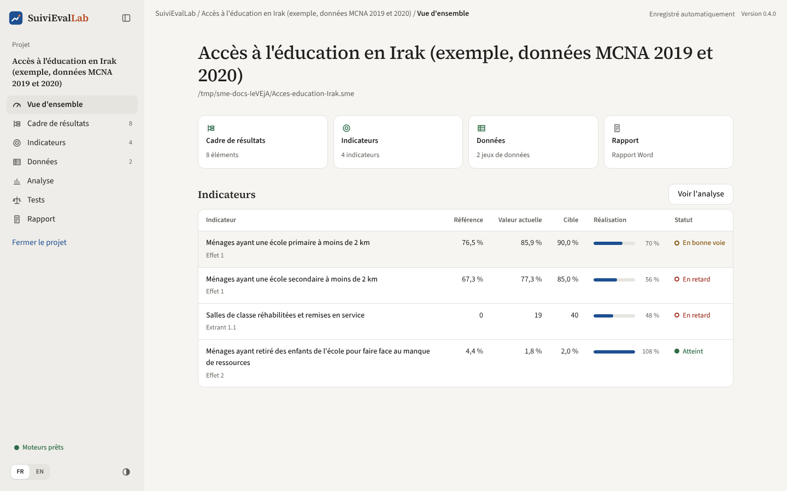
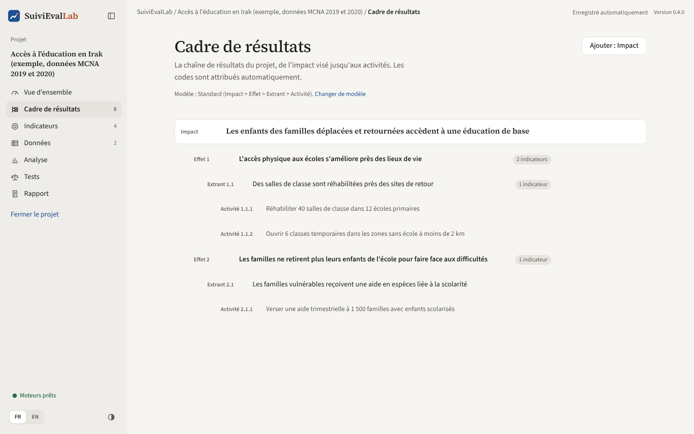
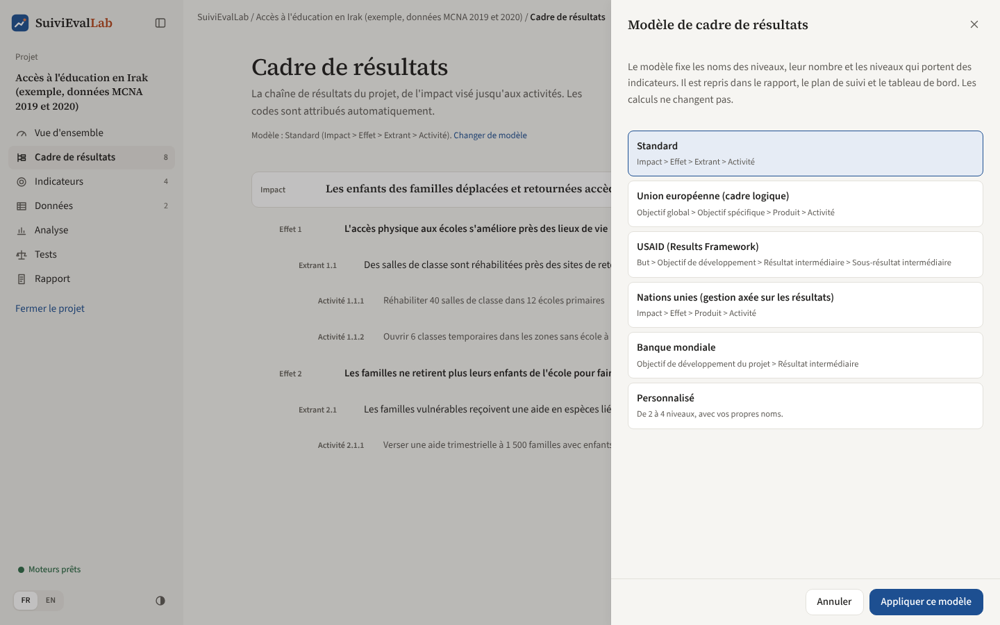
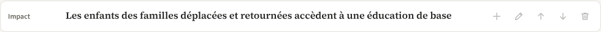

# Vue d'ensemble et cadre de résultats

## Vue d'ensemble

C'est l'écran qui s'affiche à l'ouverture d'un projet. Il répond en un coup d'œil à la question « où en est le projet ? ».

*Figure 6. Vue d'ensemble : chiffres clés et état de chaque indicateur.*

- **Le nom du projet** : un clic dessus permet de le renommer.
- **Quatre cartes** : nombre d'éléments du cadre de résultats, nombre d'indicateurs, nombre de jeux de données, accès au rapport. Chaque carte mène à l'écran correspondant.
- **Le tableau des indicateurs**, dans l'ordre du cadre : référence, valeur actuelle, cible, taux de réalisation (avec une barre) et statut. Le bouton **« Voir l'analyse »** ouvre le détail.

### Comment le statut est déterminé

Le **taux de réalisation** mesure la part du chemin parcouru entre la référence et la cible :

> Taux de réalisation = (valeur actuelle − référence) / (cible − référence)

Par exemple, avec une référence de 76,5 %, une cible de 90 % et une valeur actuelle de 85,9 %, le taux est (85,9 − 76,5) / (90 − 76,5) = 70 %.

| Statut | Règle |
|---|---|
| **Atteint** | Taux de 90 % ou plus, ou valeur actuelle déjà au niveau de la cible dans le sens souhaité |
| **En bonne voie** | Taux entre 60 % et 90 % |
| **En retard** | Taux inférieur à 60 % |
| **Non évalué** | Il manque la référence, la valeur actuelle ou la cible |

Le **sens souhaité** de l'indicateur compte : pour un indicateur qui doit baisser (par exemple la part des ménages ayant retiré un enfant de l'école), une valeur actuelle inférieure ou égale à la cible est « atteinte ».

La référence vient des données de l'enquête de référence si elle est importée ; sinon, de la valeur saisie à la main dans la fiche de l'indicateur. La valeur actuelle vient de la collecte la plus récente (mi-parcours, fin de projet ou suivi).

Pour un **indicateur de suivi de routine** (voir [Indicateurs](indicateurs.md)), la valeur actuelle est la valeur à date saisie période par période. Quand des valeurs prévues sont saisies, le statut compare plutôt le réalisé au **prévu à date** : 90 % du prévu ou plus, l'indicateur est en bonne voie ; en dessous, il est en retard. Une cible déjà atteinte donne toujours « Atteint ».

## Cadre de résultats

Le cadre de résultats décrit la logique du projet, du changement de long terme visé jusqu'aux activités.

*Figure 7. Le cadre de résultats du projet d'exemple.*

### Les niveaux et le modèle du bailleur

Les niveaux du cadre dépendent du **modèle** choisi à la création du projet (voir [Prise en main](accueil.md)). Avec le modèle standard :

| Niveau | Définition dans l'application | Peut porter des indicateurs |
|---|---|---|
| **Impact** | Le changement de long terme auquel le projet contribue | Oui |
| **Effet** | Un changement de comportement ou de situation chez les bénéficiaires | Oui |
| **Extrant** | Un produit ou un service livré par le projet | Oui |
| **Activité** | Une action menée pour produire l'extrant | Non |

Avec le modèle de l'Union européenne, les mêmes niveaux s'appellent Objectif global, Objectif spécifique, Produit et Activité ; avec celui de l'USAID, But, Objectif de développement, Résultat intermédiaire et Sous-résultat intermédiaire, et les quatre niveaux portent des indicateurs. Les noms du modèle sont repris partout : arbre du cadre, fiches des indicateurs, analyse, rapport Word, plan de suivi et tableau de bord.

Chaque niveau se place sous le niveau supérieur. Les **codes** (1, 1.1, 1.1.1) sont attribués automatiquement et se mettent à jour quand on déplace un élément.

### Changer de modèle

Le modèle est rappelé sous le titre de l'écran. Le lien **« Changer de modèle »** ouvre le panneau suivant :

*Figure 8. Le modèle du cadre peut être changé à tout moment.*

Le changement ne touche ni les résultats ni les indicateurs : seuls les noms des niveaux changent. Il est refusé dans deux cas, avec un message qui explique pourquoi : le nouveau modèle a moins de niveaux que le cadre n'en utilise (la Banque mondiale n'en a que deux), ou un indicateur est rattaché à un niveau qui n'en porte pas dans le nouveau modèle.

Un **modèle personnalisé** compte de 2 à 4 niveaux. Pour chacun, on donne le nom en français et en anglais (le rapport peut être produit dans les deux langues) et on indique s'il porte des indicateurs.

### Hypothèses

La fiche d'un résultat comporte, sous l'intitulé et la description, un champ **Hypothèses** : les conditions extérieures au projet dont dépend le passage au niveau supérieur (« la situation sécuritaire permet l'accès aux écoles »). Elles s'affichent sous le résultat dans l'arbre et forment une colonne du cadre dans le rapport et dans le plan de suivi, comme dans un cadre logique.

### Les actions

- **« Ajouter un impact »** (en haut à droite) : crée un nouvel impact.
- Au survol d'une ligne, des boutons apparaissent :

*Figure 9. Les actions disponibles sur un élément du cadre.*

| Bouton | Action |
|---|---|
| Plus | Ajouter un élément en dessous (le niveau suivant est choisi automatiquement) |
| Crayon | Modifier l'intitulé, la description et les hypothèses |
| Flèches | Monter ou descendre l'élément parmi ses voisins |
| Corbeille | Supprimer l'élément ; s'il a des éléments ou des indicateurs rattachés, ils sont supprimés avec lui, après confirmation |

À droite de chaque résultat, le nombre d'indicateurs rattachés est affiché.

Le cadre est repris dans le rapport Word (chapitre « Cadre de résultats ») et dans le plan de suivi Excel (deuxième feuille).
