# Données

L'écran Données gère les jeux de données du projet : un jeu par collecte (référence, mi-parcours, fin de projet, suivi), plus d'éventuels fichiers complémentaires (individus, contenants, etc.).

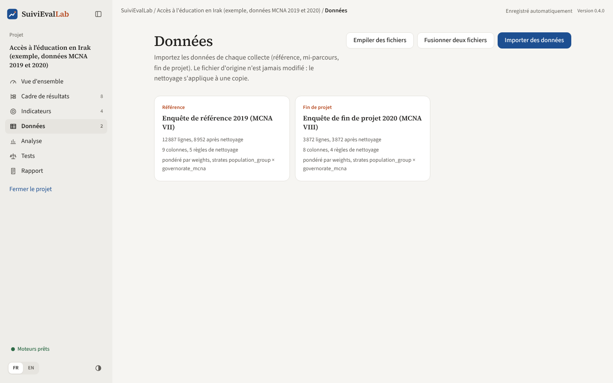

*Figure 13. Les jeux de données du projet, avec leur collecte et leur plan d'enquête.*

Chaque carte indique la collecte, le nom, le nombre de lignes importées et après nettoyage, le nombre de colonnes et de règles, et le plan d'enquête. En haut à droite : **« Importer des données »** et, dès qu'il y a deux fichiers, **« Empiler des fichiers »** et **« Fusionner deux fichiers »**.

## Importer un fichier

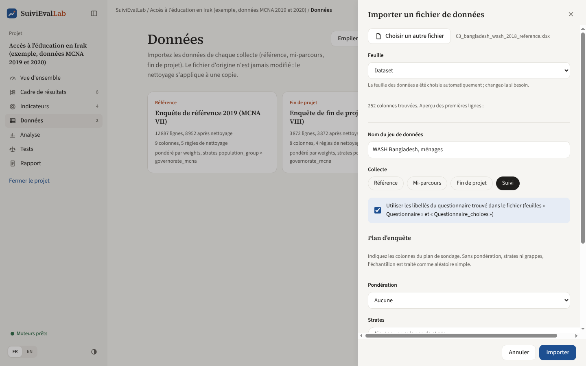

*Figure 14. L'import d'un fichier Kobo avec son questionnaire.*

1. **« Choisir un fichier »** : Excel (`.xlsx`, `.xlsm`, `.xls`), CSV, SPSS (`.sav`, `.zsav`) ou Stata (`.dta`).
2. **Feuille** : pour un classeur à plusieurs feuilles, l'application choisit celle qui contient les données (la plus grande) ; on peut en choisir une autre. Les 5 premières lignes s'affichent pour vérifier.
3. **Nom du jeu de données** : tel qu'il apparaîtra dans l'analyse et le rapport.
4. **Collecte** : Référence, Mi-parcours, Fin de projet ou Suivi. C'est ce qui permet de comparer la référence et la fin de projet.
5. **Questionnaire** : si le classeur contient aussi le questionnaire Kobo ou ODK (feuilles `survey` et `choices` au format XLSForm), une case propose de l'utiliser. Les colonnes et les codes prennent alors leurs libellés lisibles, dans toutes les langues du questionnaire.
6. **Plan d'enquête** : voir ci-dessous.
7. **« Importer »**.

Toutes les valeurs sont gardées telles quelles, sous forme de texte. Une copie est rangée dans le fichier projet : le fichier d'origine n'est jamais modifié et n'est plus nécessaire ensuite.

Les fichiers SPSS et Stata apportent leurs propres libellés de variables et de valeurs. Les codes numériques sont écrits comme on les tape (`1` et non `1.0`).

### Plan d'enquête

| Champ | Usage |
|---|---|
| **Pondération** | La colonne des poids de sondage. Proposée automatiquement si une colonne s'appelle `weights`, `weight`, `poids`, `wt`, `survey_weight` ou `hh_weight` |
| **Strates** | Une ou plusieurs colonnes de stratification ; plusieurs colonnes sont combinées (groupe de population × région). Une colonne `strata`, `strate` ou `zone` est proposée d'office |
| **Grappes (unités primaires)** | Village, zone de dénombrement ou site, si le tirage s'est fait en grappes. Une colonne `cluster`, `psu`, `village` ou `grappe` est proposée d'office |
| **Identifiant des lignes** | Sert à repérer les doublons, par exemple `_uuid` dans Kobo |

Sans pondération ni strates ni grappes, l'échantillon est traité comme **aléatoire simple**. Le plan choisi est utilisé par tous les calculs : estimations, comparaisons, tests.

> **Attention aux poids normalisés.** Certains poids sont mis à l'échelle pour que leur moyenne vaille 1. Ils corrigent correctement les pourcentages et les moyennes, mais un **effectif** pondéré n'est alors pas un nombre de ménages dans la population. L'application le signale dans l'onglet Qualité, et avertit si l'on compare des effectifs entre deux enquêtes dont les poids ne sont pas à la même échelle.

## Le détail d'un jeu de données

Un clic sur une carte ouvre le détail. En haut : la collecte, le nom, le fichier source, les nombres de lignes et de colonnes, le plan d'enquête, l'origine des libellés. Les boutons :

| Bouton | Action |
|---|---|
| **Paramètres** | Modifier le nom, la collecte, le plan d'enquête et l'identifiant |
| **Exporter les données nettoyées** | Enregistre un CSV (UTF-8, lisible par Excel) des données après nettoyage, pour R, Stata ou Excel |
| **Exporter en R** | Enregistre le journal de nettoyage sous forme de script R, avec les données brutes à côté (voir plus bas). Visible dès que le journal contient une règle |
| **Corbeille** | Supprime le jeu de données et son journal (refusé si un fichier fusionné ou empilé l'utilise) |
| **Ajouter un questionnaire XLSForm** | Lit les libellés depuis un questionnaire fourni à part |

Quatre onglets organisent le travail.

### Onglet Nettoyage : le journal

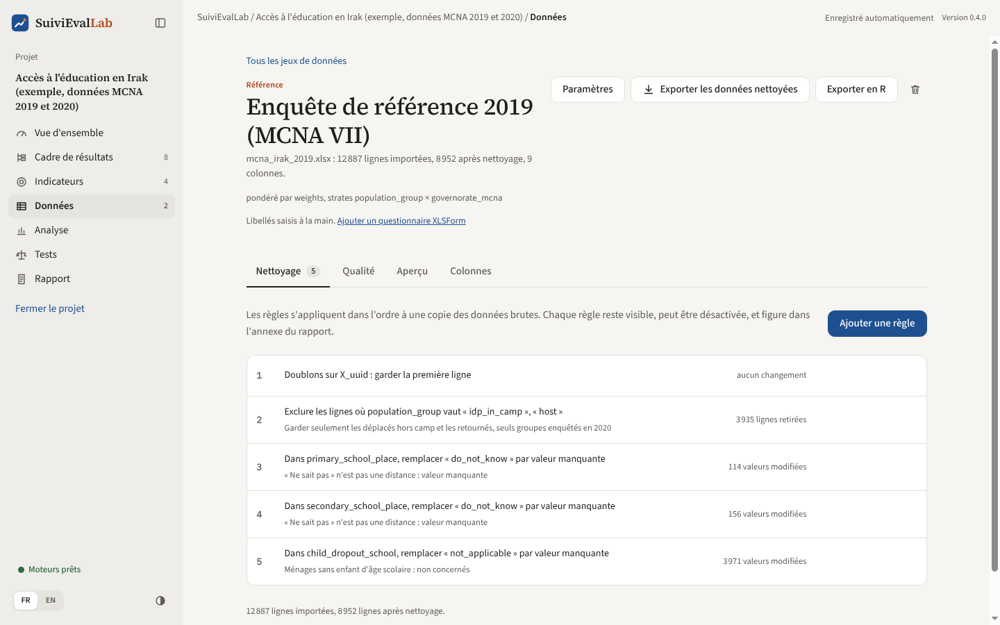

*Figure 15. Le journal de nettoyage : règles appliquées dans l'ordre, avec leur effet.*

Le nettoyage ne modifie jamais les données importées. Chaque correction est une **règle**, appliquée dans l'ordre à une copie. Chaque ligne du journal montre la règle en clair, sa justification et son **effet** (« 3 935 lignes retirées », « 114 valeurs modifiées »). Au survol : activer ou désactiver la règle, la monter ou la descendre, la supprimer. Le journal complet figure en annexe du rapport Word.

**« Ajouter une règle »** ouvre le panneau suivant :

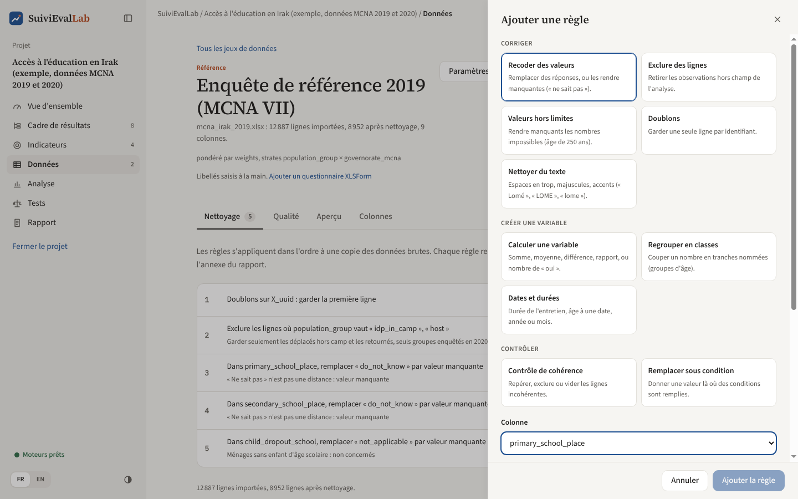

*Figure 16. Une règle de recodage : la valeur « ne sait pas » devient manquante.*

Les types de règle sont rangés en trois groupes.

**Corriger**

| Type de règle | Effet | Exemple d'usage |
|---|---|---|
| **Recoder des valeurs** | Remplace une ou plusieurs valeurs par une autre, ou par « valeur manquante » | « do_not_know » devient manquant |
| **Exclure des lignes** | Retire les lignes où une colonne prend certaines valeurs (y compris « manquant ») | Retirer les ménages hors du champ de l'enquête |
| **Valeurs hors limites** | Met en manquant les nombres hors d'un intervalle ; les valeurs observées sont rappelées | Âge hors de [0 ; 110] |
| **Doublons** | Garde la première ligne de chaque groupe de lignes identiques sur les colonnes choisies | Doublons d'identifiant |
| **Nettoyer du texte** | Retire les espaces en début et en fin, réduit les espaces multiples, retire les accents, change la casse | « Lomé », « LOME » et « lome » deviennent identiques avant un recodage |

**Créer une variable**

| Type de règle | Effet | Exemple d'usage |
|---|---|---|
| **Calculer une variable** | Nouvelle colonne : somme, moyenne, minimum ou maximum de plusieurs colonnes, différence ou rapport de deux colonnes, ou nombre de colonnes qui prennent certaines valeurs | Taille du ménage = adultes + enfants ; nombre de pratiques d'hygiène déclarées « oui » |
| **Regrouper en classes** | Nouvelle colonne qui range un nombre dans des classes nommées | Groupes d'âge : moins de 18 ans, 18 à 59 ans, 60 ans et plus |
| **Dates et durées** | Nouvelle colonne : durée en minutes entre deux dates, âge en années révolues à une date, année ou mois d'une date | Durée de l'entretien à partir de `start` et `end` d'un formulaire Kobo |

**Contrôler**

| Type de règle | Effet | Exemple d'usage |
|---|---|---|
| **Contrôle de cohérence** | Repère les lignes qui remplissent des conditions incohérentes, puis les signale dans une nouvelle colonne (1 ou 0), les exclut, ou vide une colonne pour ces lignes | Plus d'enfants que de membres du ménage ; entretien de moins de 15 minutes |
| **Remplacer sous condition** | Donne une valeur (ou « manquant ») à une colonne existante ou nouvelle, là où des conditions sont remplies | Mettre « 0 » au nombre de repas manqués quand la question filtre a reçu « non » |

Pour chaque règle, on choisit la colonne, on coche les valeurs concernées (avec leur nombre d'occurrences) ou on remplit le formulaire du type choisi, et on écrit une **justification**, reprise dans le rapport.

#### Variables créées

Les règles des groupes « Créer une variable » et « Contrôler » peuvent ajouter une colonne. Son nom s'écrit en lettres sans accent, chiffres, `_` et point, commence par une lettre, et ne doit pas déjà exister. La nouvelle colonne apparaît ensuite **dans toutes les listes de colonnes** : les règles suivantes du journal, les fiches des indicateurs, la désagrégation, les clés de fusion et le plan d'enquête. Une variable calculée peut donc servir d'indicateur, de groupe de désagrégation ou de pondération. Dans l'onglet Colonnes, elle porte la mention « créée ».

Une règle s'applique après celles qui la précèdent dans le journal. Une règle qui utilise une colonne créée plus bas attend : elle n'a pas d'effet tant que l'ordre n'est pas corrigé.

**Exemple : repérer les entretiens trop courts.** Dans l'enquête WASH du Bangladesh, une première règle « Dates et durées » calcule la durée de chaque entretien à partir des colonnes `start` et `end` du formulaire Kobo, proposées d'office quand elles existent. Les dates Kobo (avec fuseau horaire), AAAA-MM-JJ, JJ/MM/AAAA et les numéros de date d'Excel sont reconnus.

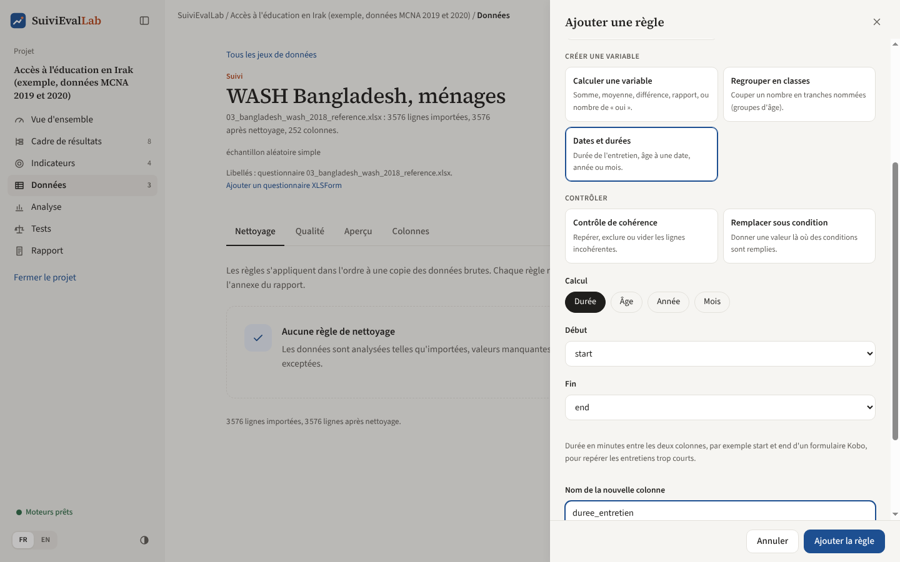

*Figure 17. La durée de l'entretien calculée à partir des colonnes start et end.*

Une seconde règle, de type « Contrôle de cohérence », signale les entretiens de moins de 15 minutes dans une colonne `entretien_court` :

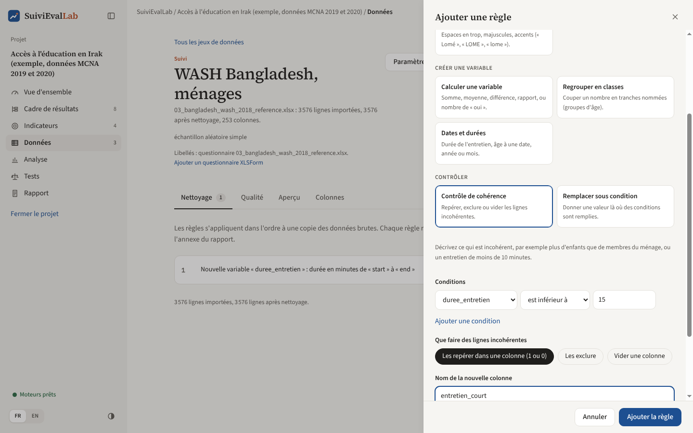

*Figure 18. Un contrôle de cohérence sur la colonne créée par la règle précédente.*

Les conditions se combinent : **« Toutes les conditions »** (et) ou **« Au moins une condition »** (ou), jusqu'à six. Les opérateurs sont : est égal à, est différent de, est parmi, n'est pas parmi (valeurs séparées par des virgules), est inférieur, inférieur ou égal, supérieur, supérieur ou égal à (pour les nombres), est manquant, est renseigné.

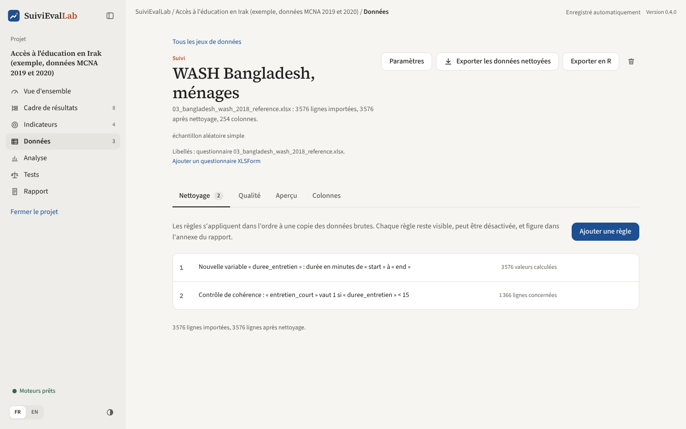

*Figure 19. Le journal : 1 366 entretiens sur 3 576 durent moins de 15 minutes.*

Le journal montre l'effet de chaque règle : le nombre de valeurs calculées, de lignes concernées par un contrôle, de valeurs modifiées ou de lignes retirées. Signaler plutôt qu'exclure laisse la décision à l'équipe : la colonne `entretien_court` peut servir de désagrégation pour voir si les entretiens courts donnent des résultats différents, avant de décider de les exclure.

#### Exporter le journal en script R

**« Exporter en R »** enregistre deux fichiers côte à côte : le script (`Nettoyage-<nom>.R`) et les données brutes (`Nettoyage-<nom>_brut.csv`, toutes les colonnes en texte). Le script n'utilise que R de base, sans package à installer. Il lit les données brutes, applique les codes de valeur manquante puis chaque règle active dans l'ordre, avec la justification en commentaire. Il produit la même table que l'application : un statisticien, un auditeur ou un bailleur peut refaire tout le nettoyage sans SuiviEvalLab, ou le poursuivre dans R.

### Onglet Qualité : le diagnostic

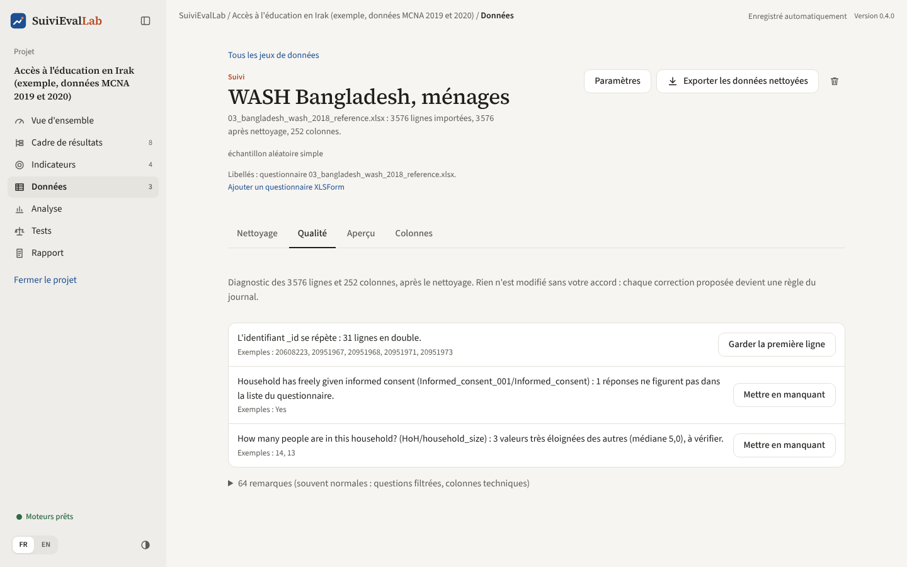

*Figure 20. Diagnostic de l'enquête WASH du Bangladesh : doublons, réponse hors questionnaire, valeurs extrêmes.*

L'application examine les données **après nettoyage** et liste les problèmes. Rien n'est modifié sans l'accord de l'utilisateur : chaque problème qui a une correction évidente propose un bouton qui crée la règle correspondante dans le journal.

| Problème signalé | Correction proposée |
|---|---|
| Identifiant en double | Garder la première ligne |
| Lignes identiques (sans identifiant) | Retirer les doublons |
| Pondération manquante, nulle ou négative | Exclure ces lignes |
| Réponses absentes de la liste du questionnaire | Mettre en manquant |
| Texte dans une colonne de nombres | Mettre en manquant |
| Valeurs très éloignées des autres | Mettre en manquant (au-delà d'une limite proposée) |

Les **valeurs extrêmes** sont repérées au-delà de trois écarts interquartiles, sur une échelle logarithmique pour les montants très étalés (dépenses, revenus). Elles ne sont signalées que si elles sont rares (au plus 2 % des valeurs) ; au-delà, c'est la forme de la distribution, pas une erreur. Une valeur extrême n'est pas forcément fausse : un ménage de 26 personnes existe. C'est à l'utilisateur de décider.

En bas, une ligne repliée regroupe les **remarques**, souvent normales : colonnes vides, colonnes à valeur unique, questions filtrées avec beaucoup de manquants, poids normalisés.

### Onglet Aperçu

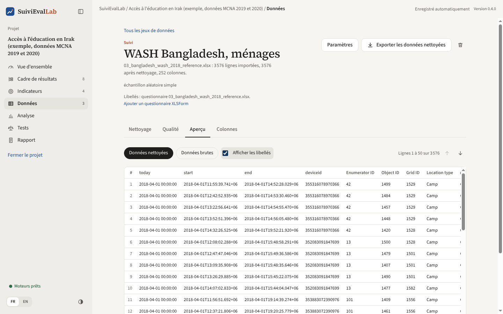

*Figure 21. Aperçu des données, avec les libellés du questionnaire.*

Affiche les données par pages de 50 lignes. **Données nettoyées** ou **Données brutes** permet de comparer avant et après le journal. **Afficher les libellés** remplace les codes par leurs libellés.

### Onglet Colonnes et libellés

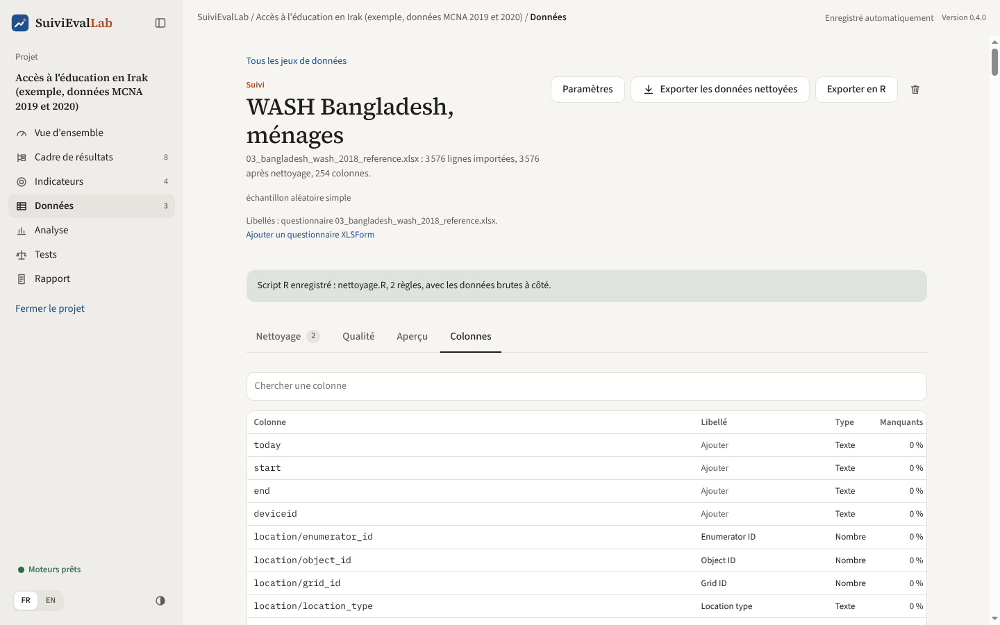

*Figure 22. La liste des colonnes, avec type, manquants et libellés.*

Pour chaque colonne : son libellé, son type (nombre ou texte), la part de manquants, le nombre de valeurs distinctes et, pour les nombres, le minimum et le maximum. Les colonnes créées par le journal suivent les colonnes importées, avec la mention « créée ». Un champ de recherche filtre les colonnes.

Un clic sur **« Ajouter »** ou sur un libellé ouvre la saisie des libellés :

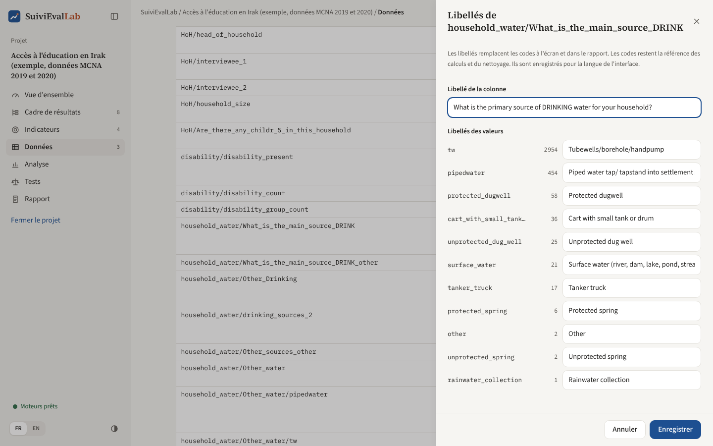

*Figure 23. Libellés d'une colonne et de ses valeurs.*

On y saisit le libellé de la colonne et ceux de chaque valeur (jusqu'à 40 valeurs). Les libellés sont enregistrés dans la langue de l'interface. Ils servent à l'affichage, dans l'analyse et dans le rapport ; **les calculs utilisent toujours les codes**.

## Fusionner deux fichiers

Les exports Kobo séparent souvent les données en plusieurs feuilles : une ligne par ménage d'un côté, une ligne par membre du ménage (ou par contenant d'eau, par enfant) de l'autre. La fusion rattache à chaque ligne du fichier principal la ligne correspondante de l'autre fichier.

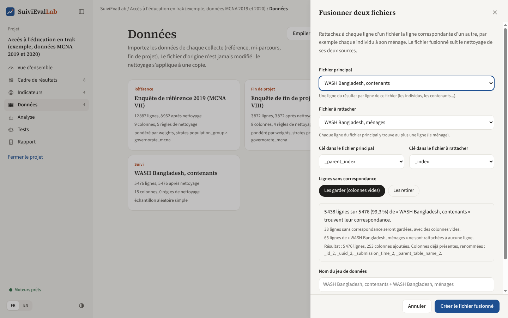

*Figure 24. Chaque contenant d'eau rattaché à son ménage.*

1. **Fichier principal** : celui qui donne une ligne par ligne du résultat (les individus, les contenants).
2. **Fichier à rattacher** : celui où chaque ligne du fichier principal trouve au plus une ligne (le ménage).
3. **Clés** : la colonne qui relie les deux. Pour un export Kobo, `_parent_index` et `_index` sont proposées automatiquement.
4. **Lignes sans correspondance** : les garder (avec des colonnes vides) ou les retirer.
5. Le **contrôle** s'affiche avant toute création : combien de lignes trouvent leur correspondance, combien n'en trouvent pas, combien de colonnes sont ajoutées, lesquelles sont renommées parce qu'elles existent déjà (suffixe `_2`).
6. **« Créer le fichier fusionné »**.

Le fichier fusionné ne contient pas de copie des données : il est **recalculé à partir des deux fichiers nettoyés**. Une correction faite dans le fichier des ménages se retrouve donc dans le fichier fusionné. Il a son propre journal de nettoyage. S'il n'a pas de pondération, il reprend le plan d'enquête du fichier des ménages.

Si la clé se répète dans le fichier à rattacher, la fusion est **refusée** : elle dupliquerait des lignes sans prévenir. C'est le cas de l'enquête de suivi WASH du Bangladesh, où deux versions du questionnaire ont été mises bout à bout et où les numéros de ménage recommencent à 1.

## Empiler des fichiers

Quand une même enquête arrive en plusieurs fichiers de même structure (un par région, par mois ou par équipe d'enquêteurs), **« Empiler des fichiers »** les met les uns sous les autres dans un seul jeu de données.

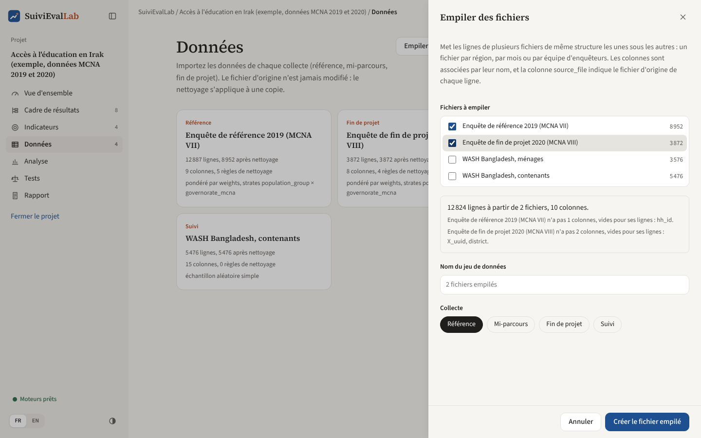

*Figure 25. Empiler deux fichiers : le contrôle indique les colonnes absentes de l'un ou de l'autre.*

1. Cochez au moins deux **fichiers à empiler**. Le nombre de lignes après nettoyage de chacun est rappelé.
2. Le **contrôle** s'affiche aussitôt : nombre total de lignes et de colonnes et, pour chaque fichier, les colonnes qu'il n'a pas. Les colonnes sont associées **par leur nom** ; une colonne absente d'un fichier reste vide pour ses lignes. Une liste de colonnes manquantes inattendue signale souvent une question renommée entre deux versions du questionnaire.
3. Donnez un nom et choisissez la collecte, puis **« Créer le fichier empilé »**.

Le fichier empilé commence par une colonne `source_file`, qui indique le fichier d'origine de chaque ligne et peut servir de désagrégation. Comme un fichier fusionné, il ne contient pas de copie des données : il est **recalculé à partir des fichiers nettoyés**, et a son propre journal. Il reprend le plan d'enquête du premier fichier coché.
