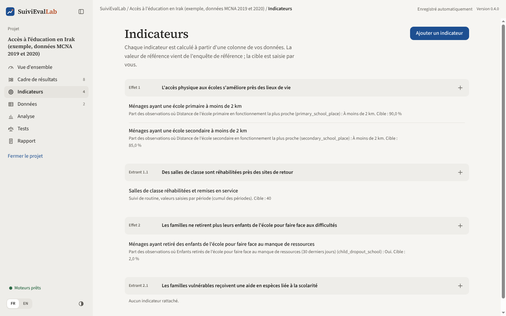
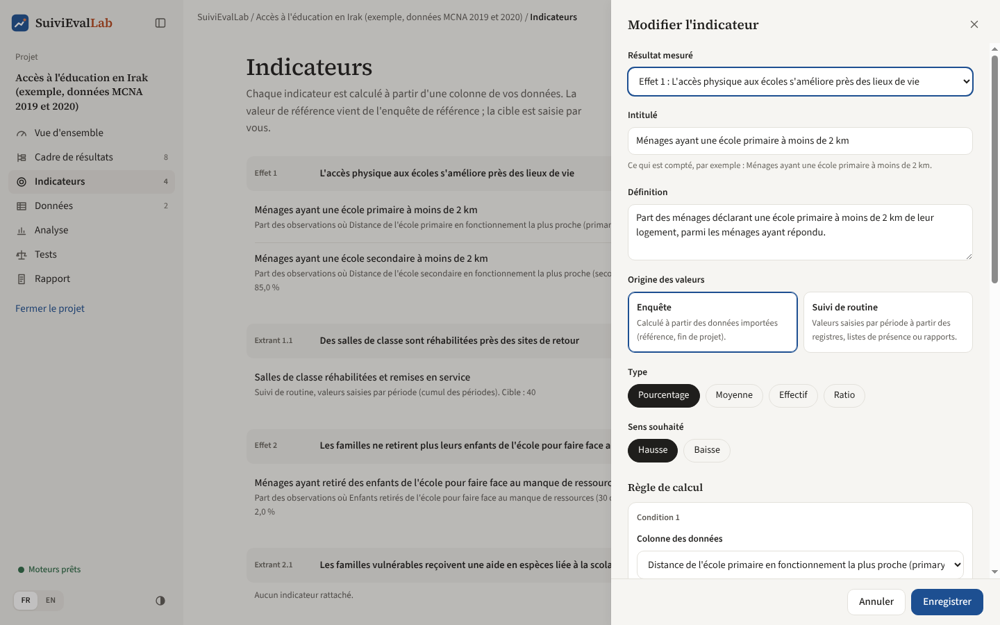
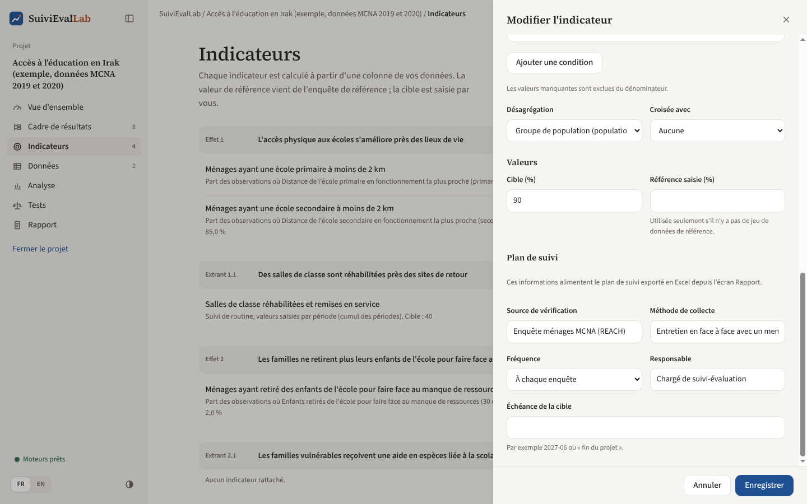

# Indicateurs

Un indicateur dit **ce qui est mesuré** et **comment le calculer à partir des données**. Il est rattaché à un résultat du cadre, à l'un des niveaux qui portent des indicateurs dans le modèle choisi (impact, effet ou extrant avec le modèle standard).

## La liste des indicateurs

*Figure 10. Les indicateurs, groupés par résultat.*

Les indicateurs sont regroupés sous le résultat qu'ils mesurent. Pour chacun, la liste rappelle la règle de calcul en une phrase et la cible.

- **« Ajouter un indicateur »** (en haut à droite) ou le **plus** à droite d'un résultat : ouvre une fiche vide.
- Au survol d'un indicateur : **modifier**, **monter**, **descendre**, **supprimer**.

L'ordre des indicateurs est celui de la vue d'ensemble, de l'analyse et du rapport.

## La fiche d'un indicateur

*Figure 11. La fiche : description, type et règle de calcul.*

### Description

| Champ | Usage |
|---|---|
| **Résultat mesuré** | L'élément du cadre auquel l'indicateur est rattaché |
| **Intitulé** | Ce qui est compté, formulé comme dans le cadre logique, par exemple « Ménages ayant une école primaire à moins de 2 km » |
| **Définition** | La définition précise (population, période, critères). Reprise dans le rapport et dans le plan de suivi |
| **Type** | Pourcentage, Moyenne, Effectif ou Ratio (voir ci-dessous) |
| **Sens souhaité** | Hausse ou Baisse : sert au statut et au taux de réalisation |

### Source : enquête ou suivi de routine

Le premier choix de la fiche est la **source** des valeurs :

| Source | Quand l'utiliser | D'où viennent les valeurs |
|---|---|---|
| **Enquête** | Indicateurs d'effet et d'impact mesurés auprès d'un échantillon | Calculées à partir des jeux de données importés, avec intervalle de confiance |
| **Suivi de routine** | Indicateurs d'extrant et d'activité tenus dans les registres, listes de présence ou rapports mensuels | Saisies période par période, ou collées depuis Excel, dans l'écran Analyse |

Un indicateur de suivi de routine n'a pas de règle de calcul sur les données. La fiche demande à la place :

| Champ | Usage |
|---|---|
| **Cumul des périodes** | Somme des périodes : le cas habituel des effectifs (personnes formées depuis le début) |
| **Dernière période** | La valeur de la dernière période : pour les taux et les stocks (taux de fréquentation ce trimestre) |
| **Moyenne des périodes** | La moyenne des valeurs saisies |
| **Répartition (facultatif)** | Jusqu'à 12 catégories séparées par des virgules (Femmes, Hommes). Chaque période peut alors être saisie par catégorie ; le total se calcule s'il est laissé vide |

La saisie des valeurs est décrite au chapitre [Analyse et tests](analyse.md).

### Les quatre types d'indicateurs

| Type | Ce qui est calculé | Exemple |
|---|---|---|
| **Pourcentage** | Part des observations qui remplissent une ou plusieurs conditions | Part des ménages dont l'école primaire est à moins de 2 km |
| **Moyenne** | Moyenne d'une colonne numérique | Nombre moyen d'enfants par ménage |
| **Effectif** | Nombre d'observations qui remplissent les conditions, ou somme d'une colonne. Avec des poids d'extrapolation, c'est un nombre estimé dans la population | Nombre de ménages ayant retiré un enfant de l'école |
| **Ratio** | Somme d'une colonne divisée par la somme d'une autre, exprimé tel quel, pour 100 ou pour 1 000 | Nombre d'enfants scolarisés pour 100 enfants en âge de l'être |

### Règle de calcul

Pour un **pourcentage** ou un **effectif** :

1. Choisissez la **colonne des données**. La liste montre les colonnes présentes dans les jeux de données, avec leur libellé quand le questionnaire est connu ; « (absente d'un jeu) » signale une colonne qui manque dans l'une des collectes.
2. Cochez les **valeurs comptées comme « oui »**. Le nombre d'observations de chaque valeur est affiché à droite, avec le libellé et le code.
3. Pour combiner plusieurs critères, **« Ajouter une condition »** (jusqu'à six), puis choisissez **« Toutes les conditions (et) »** ou **« Au moins une condition (ou) »**. Exemple : école primaire **et** école secondaire à moins de 2 km.

Les valeurs manquantes sont exclues du dénominateur. Sont considérés comme manquants les cellules vides et les codes `NA`, `N/A`, `n/a`, `NaN`, `null`, `NULL`, ainsi que les valeurs mises en manquant par une règle de nettoyage (écran Données), par exemple « ne sait pas ».

Pour une **moyenne**, choisissez une colonne numérique. Pour un **ratio**, choisissez le numérateur et le dénominateur (sommes de colonnes numériques) et l'expression : tel quel, pour 100, pour 1 000.

### Désagrégation

- **Désagrégation** : une colonne de groupe (sexe, région, groupe de population). Le résultat est calculé pour chaque groupe, avec le même plan d'enquête.
- **Croisée avec** : une deuxième colonne, pour une désagrégation croisée (par exemple groupe de population × gouvernorat).

### Valeurs et plan de suivi

*Figure 12. Valeurs et informations du plan de suivi.*

| Champ | Usage |
|---|---|
| **Cible** | La valeur visée en fin de projet. En pourcentage pour un indicateur en pourcentage (90 pour 90 %) |
| **Référence saisie** | Utilisée seulement s'il n'y a pas de jeu de données de référence, par exemple quand la référence vient d'une étude antérieure |
| **Source de vérification** | Le document ou l'enquête qui fournit la valeur |
| **Méthode de collecte** | Comment la donnée est recueillie (entretien, observation, registre) |
| **Fréquence** | Mensuelle, trimestrielle, semestrielle, annuelle, à chaque enquête, autre |
| **Responsable** | La personne ou la fonction chargée de la collecte |
| **Échéance de la cible** | Par exemple « 2027-06 » ou « fin du projet » |

Les cinq derniers champs n'interviennent pas dans les calculs : ils alimentent le **plan de suivi** exporté en Excel depuis l'écran Rapport.

**« Enregistrer »** valide la fiche. Les calculs sont refaits aussitôt.
