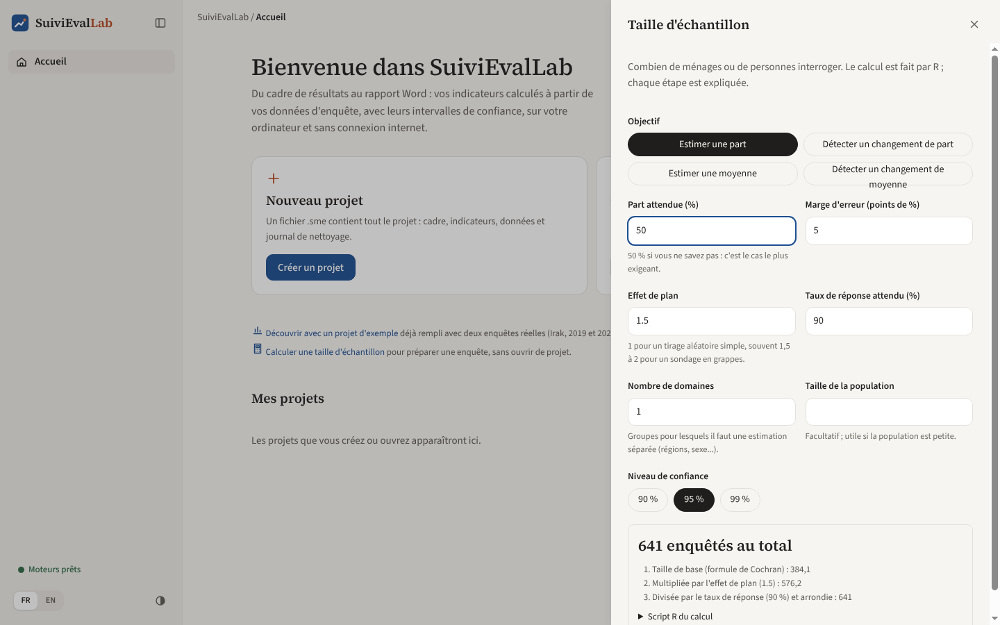
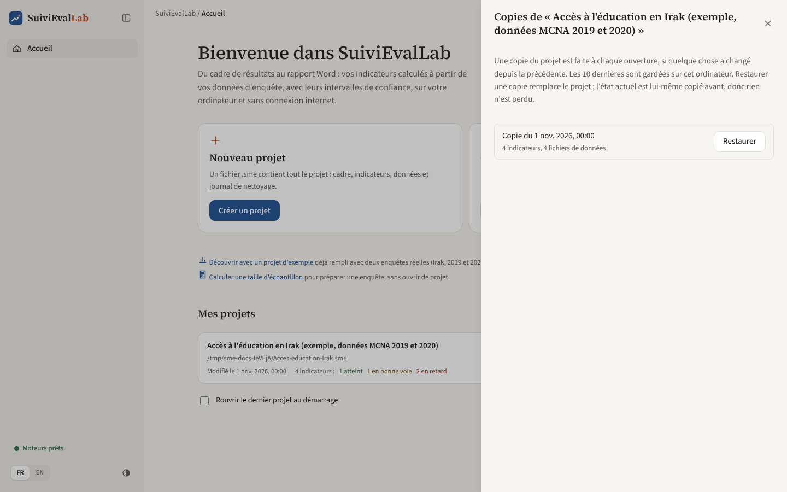
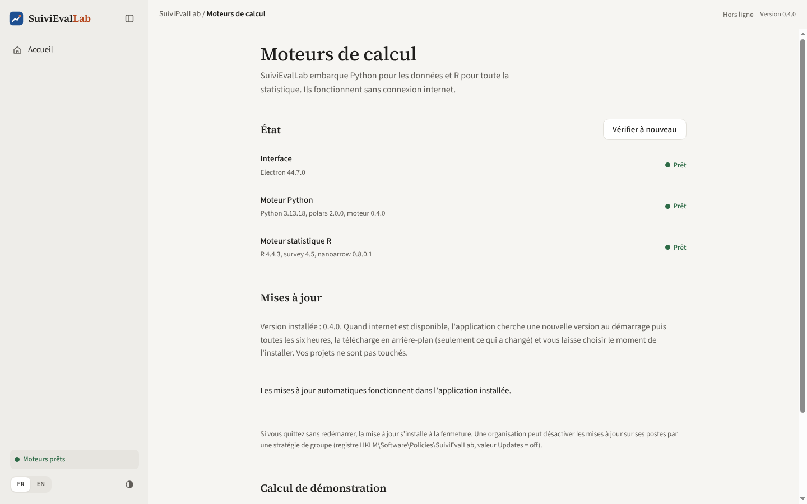

# Outils

## Taille d'échantillon

Le calculateur aide à préparer une enquête : combien de ménages ou de personnes interroger. Il s'ouvre depuis l'accueil (« Calculer une taille d'échantillon », sans projet ouvert) ou depuis l'écran Tests. Le calcul est fait par R et chaque étape est expliquée.

*Figure 36. Taille d'échantillon pour estimer une part avec une marge de 5 points.*

### Objectifs

| Objectif | Paramètres propres | Méthode |
|---|---|---|
| **Estimer une part** | Part attendue (50 % si inconnue, le cas le plus exigeant), marge d'erreur en points | Formule de Cochran |
| **Détecter un changement de part** | Part à la référence, part attendue à la fin, puissance | `power.prop.test` ; taille par collecte |
| **Estimer une moyenne** | Écart type attendu, marge d'erreur | Formule de Cochran pour une moyenne |
| **Détecter un changement de moyenne** | Écart type, changement à détecter, puissance | `power.t.test` ; taille par collecte |

### Paramètres communs

- **Effet de plan** : 1 pour un tirage aléatoire simple, souvent 1,5 à 2 pour un sondage en grappes.
- **Taux de réponse attendu** : la taille est augmentée pour compenser les refus et les absences.
- **Nombre de domaines** : les groupes qui doivent chacun avoir une estimation fiable (régions, sexe) ; la taille est multipliée d'autant.
- **Taille de la population** (facultatif) : correction pour population finie, utile quand la population est petite. Ne s'applique pas aux comparaisons.
- **Niveau de confiance** : 90 %, 95 % ou 99 %. **Puissance** (pour les changements) : 80 % ou 90 %.

Le résultat est donné en grand, suivi des étapes du calcul. Exemple : 1,96² × 0,5 × 0,5 / 0,05² = 384,1 ; multiplié par un effet de plan de 1,5 : 576,2 ; divisé par 90 % de réponse : 640,2, arrondi à **641 enquêtés**. Le script R du calcul est disponible en dessous.

## Copies automatiques

Comme il n'y a pas de bouton Enregistrer, une suppression par erreur est enregistrée tout de suite. Pour pouvoir revenir en arrière, l'application fait une **copie du projet à chaque ouverture**, si quelque chose a changé depuis la copie précédente. Les **10 dernières copies** de chaque projet sont gardées dans le dossier de l'application, sur l'ordinateur.

*Figure 37. Les copies d'un projet, accessibles depuis Mes projets.*

Pour restaurer : à l'accueil, icône **horloge** du projet, choisir la copie, **« Restaurer »**, confirmer. L'état actuel du projet est lui-même copié avant la restauration : une restauration peut donc toujours être annulée.

Les copies ne remplacent pas une sauvegarde : pour se protéger d'une panne de l'ordinateur, le fichier `.sme` doit aussi être copié ailleurs (serveur, clé USB, stockage en ligne de l'organisation).

## Moteurs et mises à jour

L'écran Moteurs s'ouvre en cliquant sur **« Moteurs prêts »** en bas de la barre latérale.

*Figure 38. État des moteurs et mises à jour.*

### État des moteurs

L'interface, le moteur Python et le moteur R, avec leurs versions et leur état (prêt, en démarrage, erreur). **« Vérifier à nouveau »** relance la vérification. En cas d'erreur, l'écran indique le dossier des fichiers journaux, à joindre à un signalement de problème.

### Mises à jour

| Élément | Rôle |
|---|---|
| Version installée et état | « À jour », « Téléchargement de la version X », « La version X est prête », etc. |
| **Chercher les mises à jour automatiquement** | Case à décocher pour arrêter les vérifications automatiques |
| **Vérifier maintenant** | Lance une vérification immédiate |
| **Redémarrer et installer** | Apparaît quand une version est téléchargée |
| **Nouveautés** | Ouvre la page de la version sur GitHub |

Quand une nouvelle version est prête, un bandeau apparaît aussi en haut de tous les écrans, avec **Redémarrer et installer**, **Plus tard** et **Nouveautés**. Si l'utilisateur ferme l'application sans redémarrer, la mise à jour s'installe à la fermeture.

Sur la capture ci-dessus, prise dans une version de développement, les mises à jour sont indiquées comme fonctionnant « dans l'application installée » : c'est normal hors de l'installeur.

### Calcul de démonstration

En bas de l'écran Moteurs, un calcul de démonstration permet de vérifier que R répond correctement : une proportion avec son intervalle de confiance, avec ou sans plan d'enquête, et le script R correspondant.
