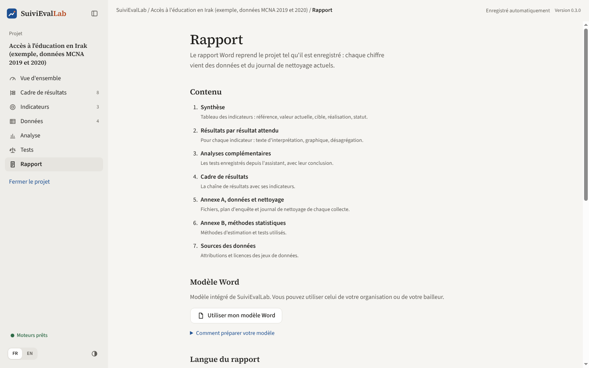
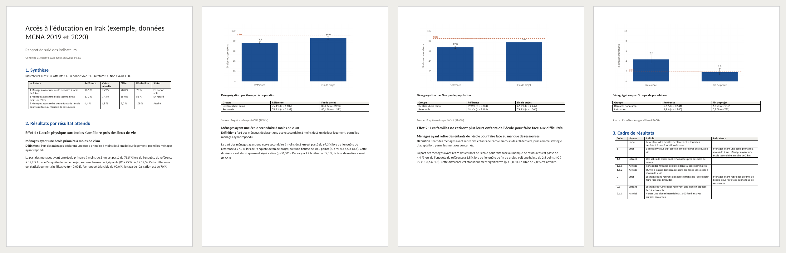
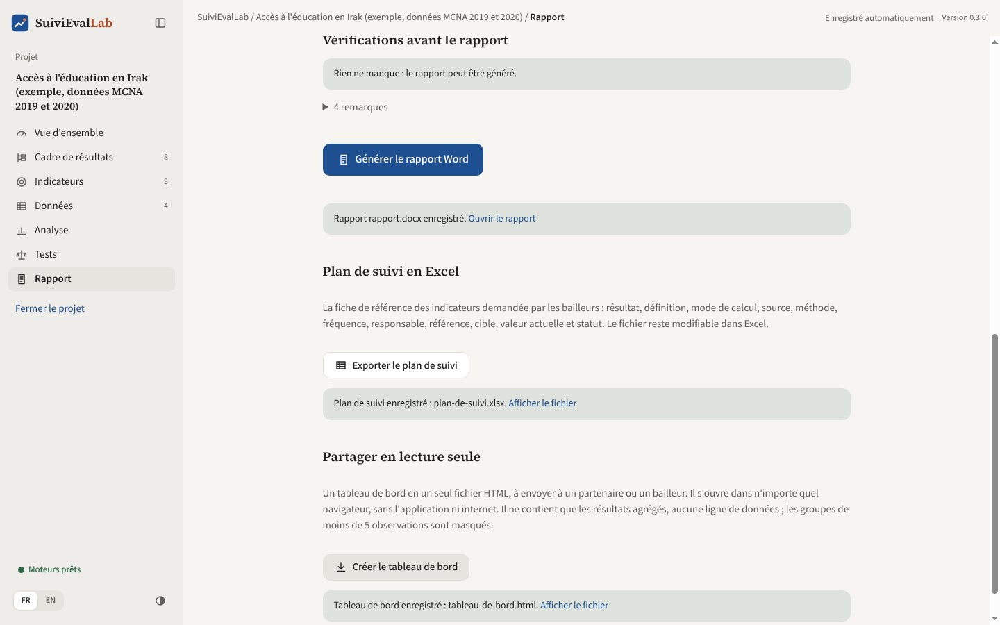
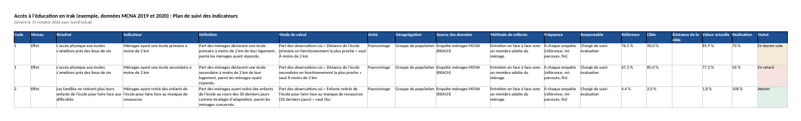
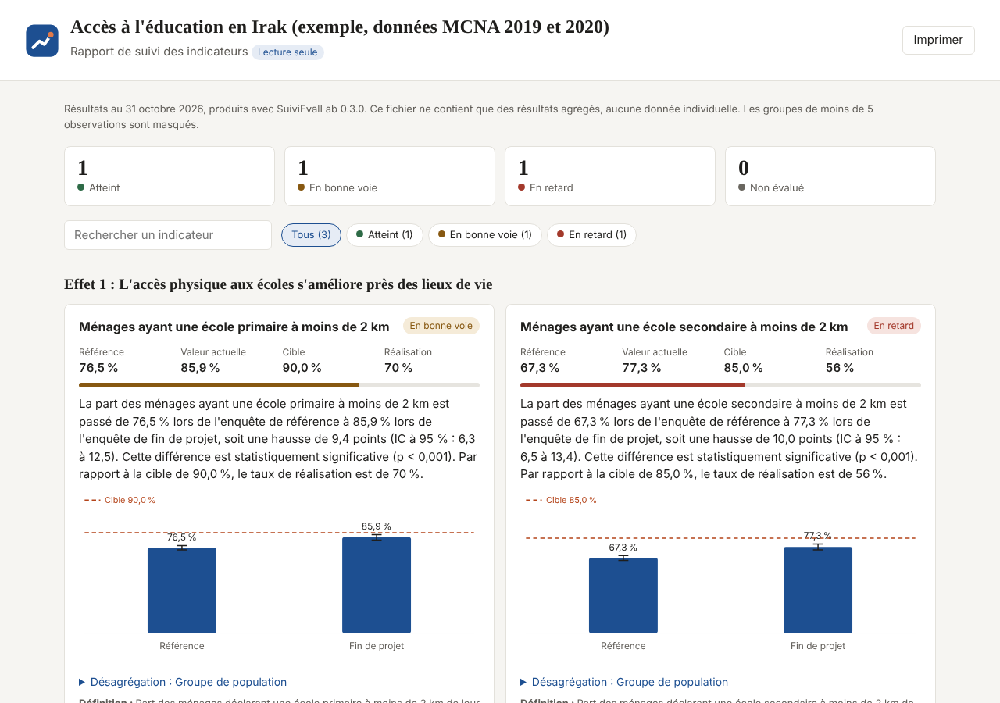

# Rapport et livrables

L'écran Rapport produit les trois documents qui sortent de l'application : le **rapport Word**, le **plan de suivi Excel** et le **tableau de bord à partager**. Tous sont produits à partir de l'état actuel du projet : il suffit de les régénérer après une correction.

*Figure 24. Le contenu du rapport et le choix du modèle Word.*

## Le rapport Word

### Contenu

| Partie | Contenu |
|---|---|
| 1. Synthèse | Tableau des indicateurs : référence, valeur actuelle, cible, réalisation, statut |
| 2. Résultats par résultat attendu | Pour chaque indicateur : définition, texte d'interprétation, graphique avec intervalles et cible, tableau de désagrégation, source |
| 3. Analyses complémentaires | Les tests enregistrés, avec leur conclusion (si des tests sont enregistrés) |
| 4. Cadre de résultats | La chaîne de résultats avec ses indicateurs |
| Annexe A. Données et nettoyage | Pour chaque collecte : fichier, date d'import, lignes, plan d'enquête, journal de nettoyage complet avec justifications et effets |
| Annexe B. Méthodes statistiques | Les méthodes d'estimation et les tests effectivement utilisés, la définition du taux de réalisation |
| Sources des données | Les attributions et licences des jeux de données |

Le texte d'interprétation suit toujours le même ordre : l'ampleur du changement d'abord, puis sa significativité, puis la position par rapport à la cible. Les nombres sont écrits dans la langue du rapport (76,5 % en français, 76.5% en anglais).

*Figure 25. Les premières pages du rapport généré pour le projet d'exemple.*

### Modèle Word de l'organisation

Par défaut, le rapport utilise une mise en page sobre intégrée à l'application. **« Utiliser mon modèle Word »** permet de partir du modèle de l'organisation ou du bailleur : page de garde, logos, en-têtes et pieds de page, styles.

Pour préparer le modèle, écrivez dans le document Word ces champs, chacun dans son propre paragraphe :

| Champ | Remplacé par |
|---|---|
| `{{contenu}}` | Tous les résultats : synthèse, indicateurs, annexes |
| `{{projet}}` | Le nom du projet (fonctionne aussi dans les en-têtes et pieds de page) |
| `{{date}}` | La date de génération |
| `{{titre_rapport}}` | « Rapport de suivi des indicateurs » |

Les titres du rapport utilisent les styles Titre 1, Titre 2 et Titre 3 du modèle : il suffit de les modifier dans Word pour changer police et couleurs. Le modèle est **enregistré dans le fichier projet** ; un collègue qui ouvre le projet l'aura aussi. Sans le champ `{{contenu}}`, les résultats sont ajoutés à la fin du document. « Revenir au modèle intégré » retire le modèle.

### Langue et génération

- **Langue du rapport** : français ou anglais, indépendamment de la langue de l'interface. Utile pour un bailleur anglophone.
- **« Générer le rapport Word »** : choisissez l'emplacement ; un message confirme l'enregistrement et propose de l'ouvrir.

## Vérifications avant le rapport

Avant de générer, l'application vérifie le projet et liste ce qui affaiblirait le rapport :

| Vérification | Pourquoi |
|---|---|
| Règle de calcul incomplète | L'indicateur ne pourra pas être calculé |
| Aucune donnée pour l'indicateur | Il apparaîtra sans valeur |
| Pas de cible, ou pas de référence | Pas de taux de réalisation ni de statut |
| Moins de 30 observations | L'estimation sera très imprécise |
| Poids à des échelles différentes | La comparaison d'effectifs n'a pas de sens |
| Fichier fusionné qui ne peut plus être calculé | Ses indicateurs seront absents |

Chaque point a un lien **« Corriger »** qui ouvre le bon écran. Les **remarques** (repliées) signalent ce qui est souvent volontaire : fichier sans pondération, indicateur sans définition, résultat sans indicateur. Les vérifications n'empêchent pas de générer le rapport.

## Plan de suivi en Excel

*Figure 26. Plan de suivi Excel et tableau de bord, en bas de l'écran Rapport.*

**« Exporter le plan de suivi »** produit la fiche de référence des indicateurs demandée par la plupart des bailleurs : une ligne par indicateur, dans l'ordre du cadre.

*Figure 27. Le plan de suivi ouvert dans un tableur.*

Colonnes : code, niveau, résultat, indicateur, définition, **mode de calcul rédigé en phrase** (avec les libellés du questionnaire), unité, désagrégation, source, méthode de collecte, fréquence, responsable, référence, cible, échéance, valeur actuelle, réalisation, statut (coloré). Une seconde feuille reprend le cadre de résultats. Le classeur reste modifiable et s'imprime en paysage sur une page de large.

## Tableau de bord à partager

**« Créer le tableau de bord »** produit **un seul fichier HTML** à envoyer à un partenaire, à un bailleur ou à la direction. Il s'ouvre dans n'importe quel navigateur, sans l'application et sans internet.

*Figure 28. Le tableau de bord tel que le voit son destinataire.*

- Chiffres clés par statut, filtres par statut et recherche d'un indicateur.
- Pour chaque indicateur : valeurs, barre de réalisation, texte d'interprétation, graphique, désagrégation dépliable, définition et source.
- Analyses complémentaires et méthodes.
- Bouton Imprimer ; mode sombre automatique ; lisible sur téléphone.

Le fichier ne contient **aucune donnée individuelle** : seulement des résultats agrégés. Les groupes de désagrégation de moins de 5 observations sont masqués, pour qu'aucune personne ne puisse être identifiée.
